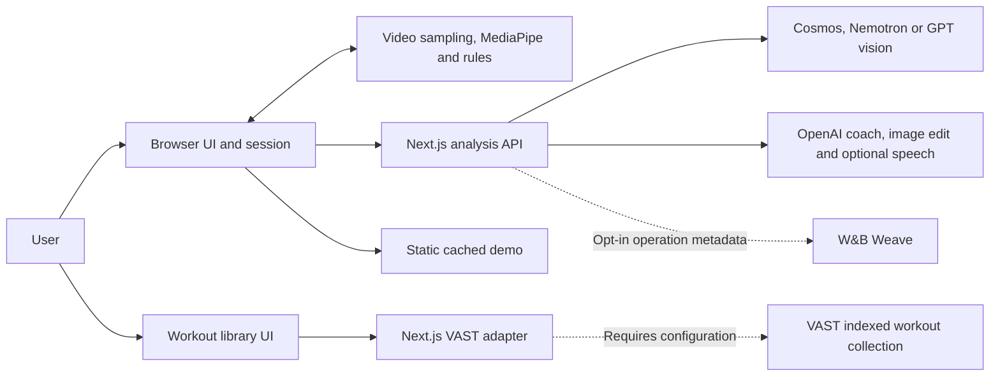
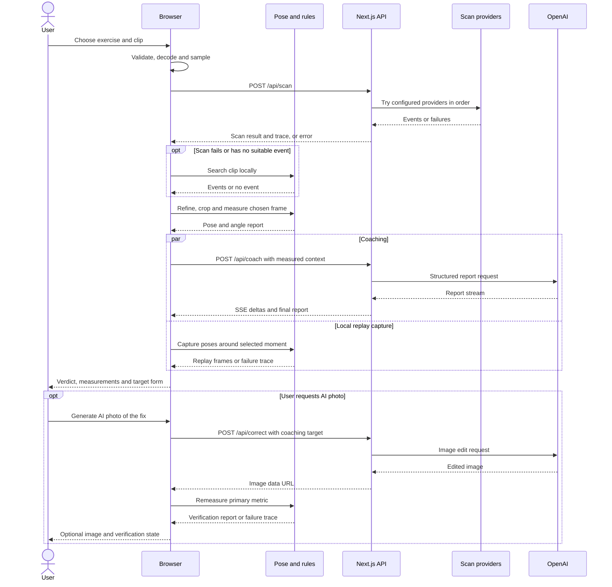

# System Architecture: Gym Bro

## Overview

Gym Bro is a Next.js web application for reviewing exercise footage. The browser samples a clip, requests a scan from configured video or vision models, selects a moment, and uses MediaPipe to estimate pose and joint measurements. A server route streams a coaching report while the browser captures poses for 3D replay. Results include a local target-form skeleton; the user can separately request an edited illustration and have the browser remeasure it. The current interface offers push-ups and pull-ups. Shared types and exercise rules also retain squats, bench presses, deadlifts, overhead presses and biceps curls; their presence does not mean the current interface offers those exercises.

This document describes the checked-in implementation. A cached pull-up example runs without new AI-provider calls. Optional VAST DATA integration retrieves existing indexed workout clips, and optional Weights & Biases Weave integration exports limited operation metadata. Both integrations need configuration and live acceptance checks. Hosting Cosmos on CoreWeave is a proposal; no CoreWeave deployment is supplied. The application has no database, job queue, account system or saved analysis history. Historical plans in [`docs/SPEC.md`](docs/SPEC.md) and [`docs/BUILD.md`](docs/BUILD.md) should be read alongside the active source, rather than treated as proof of deployed features.

## Key Requirements

- Review one short exercise clip and identify a useful frame for coaching, with timestamps that connect the report to the footage.
- Calculate measurements and rule verdicts in the browser, marking measurements that cannot be supported by the visible landmarks or camera view.
- Keep the normal analysis upload in the browser while sending selected images and derived context to configured model providers.
- Provide partial results when remote services fail: local scanning, rule-based coaching and a target skeleton each have explicit fallback states.
- Support a repeatable cached demonstration separately from fresh analysis and live sponsor-service verification.
- Keep provider credentials on the server, validate API inputs and constrain media requests and telemetry content.
- Make the current data boundaries and operational limits inspectable. No concurrency target, response-time objective or availability commitment is specified in the repository.

## High-Level Architecture

One Next.js application contains the React interface and Node.js API routes. The browser owns the active analysis session, video decoding, pose inference, measurements, verification and result rendering. API routes act as adapters to external model services. The workout library is a separate retrieval flow; selecting a library clip does not start analysis or save an uploaded analysis clip to VAST.

The diagram separates local computation, external inference, the cached demo and optional sponsor services. Weave receives approved metadata from scan attempts, coaching and correction; it does not receive every browser trace entry. The VAST collection exists outside this application and has its own ingestion process.

For an explorable view, download and open the [earlier interactive system map](docs/diagrams/gymbro.architecture.html). GitHub displays the [static preview](docs/diagrams/gymbro.architecture-preview.png); it does not run the HTML map inline. These saved artifacts predate the current on-demand photo flow. The component descriptions and sequence below describe the current implementation.

## Component Details

### Web client and session controller

The App Router exposes the upload page at `/`, analysis at `/analyze` and workout retrieval at `/library`. React, TypeScript, Tailwind CSS and Motion provide the interface. Zustand holds one active analysis session in memory, including the input, stage, frames, reports, image results and trace. Starting again resets this state and releases the current video object URL; a page reload does not restore the session.

[`usePipeline.ts`](src/hooks/usePipeline.ts) orchestrates five visible analysis steps: upload, scan, moment selection, pose and coach. In automatic exercise mode, it combines the video model's answer with a local pose classifier. Users can confirm or change the exercise and choose another detected moment. Coaching runs alongside local 3D rep capture. Image generation and verification are a separate, optional action with their own cancellation controller and state. The browser sends JSON to the API and receives JSON or server-sent events (SSE).

The results view renders the original footage, measurements, target-form overlay and a lazily loaded Three.js replay. When an after image is available, it also offers a before/after comparison. The collapsible **Under the hood** card appears above the verdict in the results column and opens by default, showing the filmstrip, timeline, analysis steps, model labels and access to the Agent Trace drawer. The view can produce a PNG for download, the native share interface or clipboard. These exports do not create a public result URL. Optional spoken coaching uses the app's OpenAI TTS route and falls back to browser speech synthesis; this is separate from narration in the README video.

Sources: [`pipeline store`](src/lib/store/pipeline.ts), [`exercise catalogue`](src/lib/exercises/catalog.ts), [`analysis page`](src/app/analyze/page.tsx), [`AnalyzeView`](src/components/analyze/AnalyzeView.tsx), [`ResultsScreen`](src/components/analyze/ResultsScreen.tsx), [`UnderTheHood`](src/components/analyze/UnderTheHood.tsx), [`AI photo controls`](src/components/results/AiPhotoPanel.tsx), [`3D view`](src/components/three/Form3DView.tsx) and [`coach voice hook`](src/hooks/useCoachVoice.ts).

### Browser video, pose and measurement engine

The browser validates file type, size and duration, then decodes the clip through an HTML video element. Accepted extensions are MP4, MOV, M4V and WebM, subject to browser codec support. The upload limit is 200 MiB and the duration limit is 60 seconds. For a remote scan, it samples up to 40 frames at a nominal 4 fps with a 448-pixel long edge and burns timestamps into the frames. Longer clips use wider sampling intervals. A contact sheet supports the GPT vision fallback.

MediaPipe runs in the browser through WebAssembly, using the heavy image model for selected frames and the lite video model for local scanning, refinement and replay capture. The loader tries local assets with GPU and CPU delegates, then remote asset fallbacks. Pose selection chooses one lifter from the detected candidates. Refinement samples around the candidate timestamp at 10 fps within a 0.6-second window on each side.

The chosen frame is cropped around the person and remeasured. Exercise rules account for view, phase and landmark visibility, then produce measurements, violations, a score and grade. The score penalises reliable deviations; missing measurements do not lower it, so a high score alone does not establish that all relevant form was observed. Coaching can adjust the displayed score by up to ten points after the local calculation.

Image verification remeasures the after image using the before image's phase and view. Its primary metric is the leading violation, or the exercise's default metric when there is no violation. A pass requires a reliable measurement within the rule-scaled tolerance. Body-proportion drift is recorded separately and does not determine the pass result. This is a limited image consistency check, not a validation of every fault or of exercise safety.

Sources: [`video probe`](src/lib/video/probe.ts), [`frame extraction`](src/lib/video/extractFrames.ts), [`pose loader`](src/lib/pose/landmarker.ts), [`moment refinement`](src/lib/moments/refine.ts), [`angle calculations`](src/lib/angles/compute.ts), [`exercise rules`](src/lib/exercises/rules.ts), [`scoring`](src/lib/exercises/score.ts) and [`verification`](src/lib/exercises/verify.ts).

### API and model-provider adapters

The API runs in the same Next.js application as the client. Server-only modules read environment settings and call external providers. Zod schemas describe request and structured response contracts. The common JSON reader checks a 4.4 MiB body cap after reading the request text; this is a rejection threshold, not a streaming memory limit.

| Route | Responsibility and communication |
| --- | --- |
| `POST /api/scan` | Calls configured scan providers in order: Cosmos, NVIDIA Nemotron, then GPT vision. Returns events, provider details and attempt traces. |
| `POST /api/coach` | Sends the selected crop, measured angles, violations and compact keypoints to OpenAI; streams report deltas and a final validated report over SSE. |
| `POST /api/correct` | On an optional user request, sends the crop and coaching target to OpenAI image editing; returns an image data URL and model metadata. |
| `POST /api/pick-frame` | Exposes contact-sheet selection separately. The normal upload pipeline uses GPT vision through the scan chain. |
| `POST /api/tts` | Requests OpenAI speech when configured. Unavailable or mock speech causes the client to use browser speech. |
| `GET /api/health` | Reports configuration flags and, with `probe=1` or `probe=true`, limited provider reachability checks. |

The scan chain skips unconfigured providers, stops at the first result containing events, and retains a valid empty result if later providers find nothing. If all configured providers fail, it returns an error and attempt trace. Cosmos supports configurable input modes, model discovery and a frame-format retry. Model names and endpoints come from [`config.ts`](src/lib/config.ts) and [`.env.example`](.env.example); their presence does not prove availability or successful inference.

Failed coaching uses a rule-based report. After results appear, the user can request an AI photo using the available coach report's corrected-pose target, or the rule-based target if no report is available. One photo action makes one correction request, then remeasures the returned image. The client does not automatically request another edit after a failed measurement check. Users can retry or regenerate manually. The provider adapter can retry a timeout or server error within its request budget, which is separate from a user-requested regeneration. If editing fails, the existing target-form skeleton remains available; if remeasurement fails, the returned image remains visible with a failed verification trace and no verification report.

Sources: [`API routes`](src/app/api), [`API contracts`](src/lib/schemas.ts), [`body/response helpers`](src/app/api/_lib/respond.ts), [`scan chain`](src/lib/providers/scanChain.ts), [`coach provider`](src/lib/providers/openaiCoach.ts) and [`image provider`](src/lib/providers/openaiImage.ts).

### Cached demonstration and static assets

`/analyze?demo=pullup` reads the checked-in video, images, pose data, scan result and coach report, then plays staged progress. It samples the real clip for the filmstrip and computes measurements from the cached pose. This path does not obtain fresh scan, coach or image-model results. `DEMO_MODE` and `MOCK_AI` also make analysis API routes return fixtures, although VAST remains independently configured.

The [pull-up metadata](public/demo/pullup/meta.json) identifies this as a synthetic cached run using real footage. The before image and pose represent 13.4 seconds; the after image is another real frame at 13.8 seconds, with `placeholderAfter: true`. It is not a generated correction. Cached trace values and simulated timings must not be treated as live performance evidence.

The fixtures are static files in [`public/demo/pullup`](public/demo/pullup). MediaPipe assets are prepared during installation. The package declares `npm run record-demo`, but the referenced `scripts/record-demo.ts` is absent in this checkout, so that command cannot currently refresh the fixtures.

### VAST DATA workout library

The library uses React state for the search query, results, selected clip and shared team access key. It retains these values only in page memory. `GET /api/vast/status` reports whether the feature is enabled and configured. Search sends a query and the team key to `POST /api/vast/search`; the server validates them before contacting VAST.

The adapter searches the configured workout tag with public results excluded. It normalises and deduplicates matching sources, returns display text and optional timestamps, and replaces source locations with opaque playback tickets. `GET /api/vast/clip?ticket=...` validates a ticket and proxies a bounded video range from the configured VAST service. Tickets expire after ten minutes. The server buffers at most 8 MiB per range and validates the media type and returned range before responding.

The collection and source footage are managed outside Gym Bro through the configured VAST service. Gym Bro implements retrieval and playback only: it has no upload-to-VAST path, indexing worker or automatic hand-off from a search result to analysis. Live behaviour still requires a suitable indexed gym collection, credentials and the [acceptance checks](docs/sponsor-integrations.md#local-evaluation-and-live-acceptance).

Sources: [`library UI`](src/components/library/WorkoutLibrary.tsx), [`VAST routes`](src/app/api/vast), [`configuration`](src/lib/vast/config.ts), [`client adapter`](src/lib/vast/client.ts) and [`bounded HTTP helpers`](src/lib/vast/http.ts).

### W&B Weave metadata exporter

The server can export scan-attempt, coaching and image-correction metadata through Weave's `/call/start` and `/call/end` endpoints. The exporter uses a strict allowlist: operation, provider, constrained model name, mode, duration, outcome, a categorical error and optional synthetic evaluation counts. It sends empty inputs and a null output. It does not export images, prompts, coach text, search queries or free-form errors.

Export requires `WEAVE_ENABLED=1` and valid server-side credentials, project and endpoint settings. Each operation is independent; there is no shared parent trace linking a complete browser analysis. The exporter has one short deadline across both requests and contains failures so they do not change the analysis outcome. It has no persistent queue or retry, so delivery is best effort. Live Weave readback remains an acceptance task.

Sources: [`trace policy`](src/lib/observability/trace.ts), [`exporter`](src/lib/observability/exporter.ts), [`server wrapper`](src/lib/observability/weave.ts) and [sponsor configuration guide](docs/sponsor-integrations.md).

## Data Flow

### Uploaded-clip analysis

1. The user selects an exercise or automatic detection and chooses a video. The browser validates and probes it, creates a local object URL and samples timestamped JPEG frames.
2. The client sends selected frames and a contact sheet to `/api/scan`. The server tries its configured scan chain while, in automatic mode, the browser classifies the exercise from poses. The client resolves the exercise from those answers; if neither identifies it, the current default is push-up with low confidence and a request to confirm. If the scan request fails, the browser scans poses locally for the resolved exercise.
3. The browser selects a candidate event. If no event is suitable, it tries local scanning and can fall back to a low-confidence middle-of-clip moment. It refines remote candidates, extracts a crop and calculates the before report.
4. Local 3D rep capture starts alongside coaching. The coach receives the selected crop, measured angles, violations, compact keypoints and event context. When coaching completes or falls back to rules, the main session reaches `done`; replay capture can still finish afterwards.
5. Results show the verdict, measurements and any target-form skeleton. The user can optionally request an AI photo. This separate action sends the crop and available coaching target to `/api/correct`, then remeasures the returned image. Failure does not remove the existing coaching result, and no automatic re-edit follows a failed check.
6. The user can inspect the trace, choose another event, change the exercise, retry or regenerate an AI photo, or export a PNG. The application does not persist a result record. A `done` main session does not establish successful photo generation, complete measurements or successful operation of every provider.

This sequence shows the provider path, local scan fallback, concurrent coaching/replay work and the separate photo action. The replay branch does not block the verdict; the diagram groups it with coaching to show that the work overlaps. The cached demo follows a separate fixture-reading path. Optional telemetry is omitted here for readability; it follows server provider operations and does not carry the media or report content.

### Indexed workout retrieval

The library checks configuration, then sends a user-entered search and shared team key to its own API. The adapter authenticates upstream, searches the chosen collection and returns display metadata with expiring playback tickets. The video player redeems a ticket through the same application, which fetches a bounded range from VAST. No analysis request, new index entry or Weave search trace is generated by this flow.

## Data Model (high-level)

The application contracts are TypeScript objects and Zod schemas. They are not database tables.

| Entity | Contents and relationships | Owner and lifetime |
| --- | --- | --- |
| Analysis session | Input file/demo ID, resolved exercise and detection source/confidence, stage, five-step status, frames, reports, score and trace | One browser Zustand store; reset or reload discards the session |
| Video metadata and sampled frame | Clip dimensions/duration; frame timestamp and image data URL | Derived in the browser; selected frames also exist transiently in API/provider requests |
| Scan result and event | Provider/model, raw response, exercise and timed issues with severity/confidence | One scan result contains zero or more events; the client selects one moment |
| Chosen moment and crop | Selected timestamp, source event and crop geometry | Links an event to the canonical before image in the session |
| Pose and rep frame | 33 image landmarks, world landmarks, dimensions; timestamped poses for replay | Browser inference output, or checked-in demo fixtures |
| Angle report and rule violation | Measurements, reliability, targets, deviations, score and grade | Derived locally from pose, exercise and static rules |
| Coach report | Summary, faults, cues, drill, corrected-pose targets and bounded score adjustment | Validated provider result or local rule-based fallback |
| Optional AI photo and verification | Separate idle/generating/verifying/done/failed state, image/model metadata; selected metric before/after, pass, body-proportion drift and attempt count | User-requested edit returned by API; verification computed in browser; independent of the completed five-step analysis |
| Browser trace entry | Step/provider/model, success, duration, error, detail and fallback flag | Appended to the current session; not a durable audit record |
| VAST search result and ticket | Opaque result ID, title, description, similarity, optional times and playback URL | Search UI state; source media stays in VAST and the ticket expires |
| Sponsor trace | Allowlisted operation metadata and mode (`live`, `mock` or `synthetic`) | Transient server export; external retention depends on Weave configuration |

Definitions: [`types.ts`](src/lib/types.ts), [`schemas.ts`](src/lib/schemas.ts), [`pipeline store`](src/lib/store/pipeline.ts), [`VAST response types`](src/lib/vast/types.ts) and [`sponsor trace types`](src/lib/observability/trace.ts).

Server process memory holds reusable provider clients, a Cosmos model-discovery cache and a short-lived VAST login-token cache. These caches are per process. There is no application-owned persistent video store, analysis database or message broker.

## Infrastructure & Deployment

### Runtime and build

[`package.json`](package.json) declares Next.js 16.4.2, React 19.3.0, TypeScript, MediaPipe, Zustand and Three.js. `npm run dev` starts development; `npm run build` creates a production build; `npm start` serves it. API routes declare the Node.js runtime. Analysis routes generally declare a 60-second maximum duration, while correction declares 90 seconds; the deployment must support the required execution time and streaming responses.

The install hook [copies MediaPipe WebAssembly assets](scripts/copy-mediapipe-wasm.mjs) into `public/mediapipe/wasm` and [downloads heavy/lite pose models](scripts/download-pose-model.mjs) into `public/models`. The browser also has remote asset fallbacks. [`next.config.ts`](next.config.ts) gives local pose assets a one-year immutable cache policy, so asset updates need cache-aware release handling. It supports `NEXT_DIST_DIR` for separate build output. The [layout](src/app/layout.tsx) uses `next/font/google`.

There is no checked-in Dockerfile, Kubernetes configuration, infrastructure-as-code definition, CI workflow or Vercel deployment manifest. [`.vercelignore`](.vercelignore) excludes local build output, raw phone footage, test footage and documentation media, screens and diagrams from Vercel uploads; this file is an upload policy, not proof of a deployed service. The source does not establish the active hosting provider, deployed URL, region, TLS termination, instance count or release process. No Node.js runtime version is pinned in a package `engines` field or version file. CoreWeave GPU hosting is documented only as a [deployment suggestion](docs/sponsor-integrations.md#coreweave-deployment-suggestion).

### Environments

| Environment or mode | Configuration | What it establishes |
| --- | --- | --- |
| Local development | `npm run dev` and `.env.local` based on `.env.example` | Local application; live providers depend on supplied endpoints and keys |
| Cached demonstration | `/analyze?demo=pullup` | Repeatable saved example; no new scan, coaching or correction inference |
| API fixture mode | `DEMO_MODE=1` or `MOCK_AI=1` | Analysis routes return fixtures; VAST has separate enablement |
| Unit/integration tests | Vitest and mocked provider transports | Selected local contracts, fallback and policy behaviour |
| Browser tests | Playwright builds/starts the app with mock AI and uses the Chrome channel | UI behaviour with controlled fixtures, not live provider accuracy |
| Production build | `npm run build` then `npm start` | Runnable build; hosting and live acceptance need separate verification |
| Staging | No distinct configuration supplied | Environment, ownership and promotion process remain unspecified |

Sources: [`.env.example`](.env.example), [`next.config.ts`](next.config.ts), [`Vitest configuration`](vitest.config.mts), [`Playwright configuration`](playwright.config.ts) and [sponsor setup](docs/sponsor-integrations.md).

## Scalability & Reliability

Analysis requests do not depend on a shared persistent session on the server, but each instance has its own provider caches. No load balancer, autoscaler, worker pool, durable queue or redundant deployment is configured here. Capacity, recovery time and provider cost under concurrent load have not been measured in the repository evidence.

Video decoding, pose inference and 3D rendering use the user's device. Sampling and clip limits bound some work, but codec support, memory, GPU availability and model loading still affect responsiveness. Scan frames target a 3.8 MiB budget; the contact sheet and JSON metadata can add to that size, so this target does not guarantee acceptance under the server's 4.4 MiB cap. The browser's 60-second clip limit also differs from the scan schema's 120-second maximum.

| Failure boundary | Implemented handling | Remaining limit |
| --- | --- | --- |
| Remote scan | Ordered provider chain and a 57-second route deadline; local pose scan after failure | Earlier attempts can consume the deadline; local inference can also fail |
| Pose initialisation | Local/remote asset and GPU/CPU attempts; failed cached initialisation can be retried | The nominal 20-second deadline allows a minimum budget for each attempt and is not a strict total bound |
| Coaching | Streaming timeout handling, a non-streaming retry in selected cases, then browser rule-based fallback | Partial text or a completed session does not prove a valid provider report |
| Optional image correction | Provider timeouts and bounded retry budget; target skeleton remains after failure; manual retry/regeneration | No automatic re-edit after a failed check or durable job after navigation/reload; an unverified image may remain |
| VAST | Bounded requests, rejected redirects, one login refresh after a 401, expiring tickets and range validation | The application buffers up to 8 MiB per range; concurrency and host response limits need testing |
| Weave | Short bounded export deadline; failures do not fail analysis | No retry or queue; start/end delivery can be incomplete |
| Navigation or a new analysis | Abort signals stop client work and propagate to requests | Cancellation does not undo work already accepted by an external provider |

The fallbacks provide useful partial behaviour; they do not establish a service-level guarantee. Long-running jobs, persistence and extra instances should follow measured requirements rather than assumptions about deployment scale.

## Security & Compliance

### Implemented controls

Provider settings are read through server-only modules, and environment files are ignored apart from `.env.example`. API contracts use Zod validation; provider helpers redact configured keys and recognised secret patterns from surfaced errors. Most analysis responses request no caching. These controls do not provide a complete access-control or retention policy.

VAST search requires a separate shared application access key, compared through constant-time digest comparison. Upstream credentials remain server-side. The endpoint normally requires HTTPS, with an explicit exception for a trusted HTTP environment. Search results expose encrypted and signed ten-minute playback tickets instead of upstream locations. A ticket grants playback to anyone who possesses it until expiry; it is not bound to an individual user. Video responses are bounded, validated and marked `no-store` and `nosniff`.

Weave destinations come from server configuration and require HTTPS. The exporter rejects redirects, sanitises metadata and avoids retaining response bodies. The local browser trace is a different mechanism: it can contain scan text and error details and is not governed by the Weave content allowlist.

Sources: [`server configuration`](src/lib/config.ts), [`API validation and cache headers`](src/app/api/_lib/respond.ts), [`provider error handling`](src/lib/providers/http.ts), [`VAST configuration and access check`](src/lib/vast/config.ts), [`VAST tickets and playback`](src/lib/vast/client.ts), [`bounded VAST requests`](src/lib/vast/http.ts), [`trace policy`](src/lib/observability/trace.ts), [`Weave exporter`](src/lib/observability/exporter.ts) and [`.gitignore`](.gitignore).

### Access and data-protection boundaries

There is no individual account/authentication system, per-user authorisation, general API rate limiter or user quota. The VAST shared key protects library search, but the core paid analysis routes and optional health probes do not have an application-level authentication check. Development pages such as `/dev/gallery` and `/dev/pose` also have no production-only access guard in their source.

The normal upload flow sends selected frames or contact sheets to scan providers, a crop plus measurements to the coach, and a crop plus target prompt to image editing. Optional server speech receives the summary text. The scan API additionally accepts a video data URL from direct clients. There is no implemented face/bystander redaction or upload consent workflow. Browser-local pose inference does not make the complete AI analysis local.

Deployment TLS, proxy logging, provider retention, regional processing, consent arrangements and deletion processes are not established by this repository. Cosmos/NVIDIA endpoints are server settings without the VAST adapter's HTTPS policy. The VAST upstream playback request includes its upstream token in a server-to-server query string, so upstream access-log handling needs consideration when deploying it. Encrypted playback tickets do not establish encryption of stored footage.

The project contains no evidence of a compliance certification or clinical validation. The intended use, privacy notice, provider agreements and retention policy need to be defined before accepting identifiable user footage in a public service. Measurement and verification labels must preserve the distinction between a coaching estimate and an established safety outcome.

## Observability

The browser's expanded **Under the hood** card sits above the verdict and exposes the sampled footage, timeline, five analysis steps, model labels and the Agent Trace button. The drawer shows session entries, selected timestamps and raw scan output. Entries include local operations, provider attempts, cached steps and fallbacks. Although the card labels their count as model calls, this is a count of trace entries, including browser operations. It is not a count of external model calls. Summed durations can overlap because automatic exercise classification runs alongside the remote scan, and replay capture runs alongside coaching. Optional photo generation adds separate correction and verification entries. The session trace disappears with the browser state.

Opt-in Weave export covers server scan attempts, coaching and image correction. It currently does not cover VAST retrieval, TTS, the standalone pick-frame route, local pose or health probes. Each export creates its own trace ID; the implementation has no complete request-correlation tree. A configuration flag or mocked export test does not establish that a live Weave project received an event.

`GET /api/health` normally returns `ok: true` with configuration flags. Its optional probes call Cosmos model discovery and OpenAI coach-model metadata with four-second timeouts. They do not perform inference or test Nemotron, image generation, TTS, VAST, Weave or local pose. Probe failures appear in the response body without turning the overall health response into a failing HTTP status. `/api/vast/status` and Weave's health flags also describe configuration presence, not a live connection.

The application uses a few console messages for errors and development pose diagnostics. It has no general central log collector, metrics exporter, alerting setup or cost dashboard. `npm run eval:sponsors` runs synthetic policy checks; `--export` explicitly requests export of the synthetic result. It does not measure video accuracy, call inference models or establish production reliability.

Sources: [`results layout`](src/components/analyze/ResultsScreen.tsx), [`UnderTheHood`](src/components/analyze/UnderTheHood.tsx), [`AgentTrace`](src/components/results/AgentTrace.tsx), [`pipeline orchestration`](src/hooks/usePipeline.ts), [`health route`](src/app/api/health/route.ts), [`VAST status route`](src/app/api/vast/status/route.ts), [`exporter`](src/lib/observability/exporter.ts), [`evaluation policy`](src/lib/observability/evaluation.ts) and [`evaluation script`](scripts/eval-sponsors.ts).

## Trade-offs & Decisions

| Implemented choice | Benefit | Cost or limit |
| --- | --- | --- |
| One Next.js application | UI and API share types, contracts and a build | Releases are coupled; the host must support long requests and SSE |
| Browser pose inference | Avoids server pose-compute work and keeps that computation local | Performance depends on the device and supported video codecs |
| Sampled frames and contact sheets | Reduces media transferred for analysis | Sparse samples can miss a moment; complete request size still needs enforcement |
| Ordered scan fallback chain | Uses alternative configured providers when a scan fails or is empty | Sequential attempts add latency and can exhaust the route budget |
| Code-based measurements and rule targets | Gives calculations and fallback coaching an inspectable basis | Pose estimates and exercise thresholds need evaluation; missing values can limit scores |
| Five-step analysis with an optional AI photo | Shows coaching and local target form without waiting for image generation; uses the available coach target when requested | The user must request the photo separately; generation and verification can still fail |
| One primary-metric image check | Supplies a bounded remeasurement criterion | Other faults and body-proportion drift can remain when it passes |
| Transient sessions and local PNG export | Avoids storage and account infrastructure | No saved history, recovery after reload or shareable analysis URL |
| Cached demonstration | Provides a repeatable example without provider calls | Synthetic reports, staged timings and a placeholder image need clear provenance |
| Optional VAST retrieval | Reuses an existing indexed collection without adding ingestion | Shared access, dataset preparation and upstream operation remain separate concerns |
| Metadata-only Weave export | Records operation outcomes while limiting content disclosure | No report inspection, full session trace or guaranteed delivery |

These are consequences of the current implementation. They are not evidence that the original authors recorded each choice as a formal architecture decision.

## Future Improvements

The following are proposed work, not completed features or an agreed delivery schedule:

- Configure a gym-specific VAST collection and credentials, then verify a genuine query, empty result, expired ticket, access failure and playable range against the live service. Confirm upstream media rights and dataset access before adding ingestion.
- Enable Weave for an approved project and inspect a live event's destination, metadata, timings and absence of content. Decide whether session correlation, delivery monitoring or evaluation datasets are needed.
- Evaluate CoreWeave hosting for Cosmos after choosing the model, GPU requirements, deployment owner, cost limit and rollback approach. No GPU service is provisioned by the current integration.
- Choose and document the application host, Node.js runtime, staging/production boundaries, secret rotation and release process. Add reproducible deployment and CI configuration for that choice.
- Define an access model for paid analysis routes, library callers, probes and development pages. Add quotas, rate limits and cost controls appropriate to that model.
- Document consent, provider data handling, retention and deletion. Evaluate whether face/bystander redaction or regional processing constraints are needed for the intended use.
- Reconcile browser/API duration limits and budget the complete scan request, including the contact sheet. Validate host request/response limits for both analysis and VAST playback.
- Restore or remove the missing demo-recording command and make cached-fixture provenance visible throughout the UI. Preserve a clear label while the after image remains a real later frame.
- Evaluate exercise rules against a documented dataset and report measurement coverage alongside scores. Decide whether verification should include more metrics or body-proportion drift. If adding automatic re-edits, bound their cost and ensure feedback uses the same primary metric as the check.
- Measure device performance, concurrency, provider latency, failures and cost. Add structured redacted logs, useful alerts and correlation before introducing background jobs or scaling infrastructure.
- Add persistence only if saved history or resumable analysis becomes a requirement, together with an explicit access and retention model.
