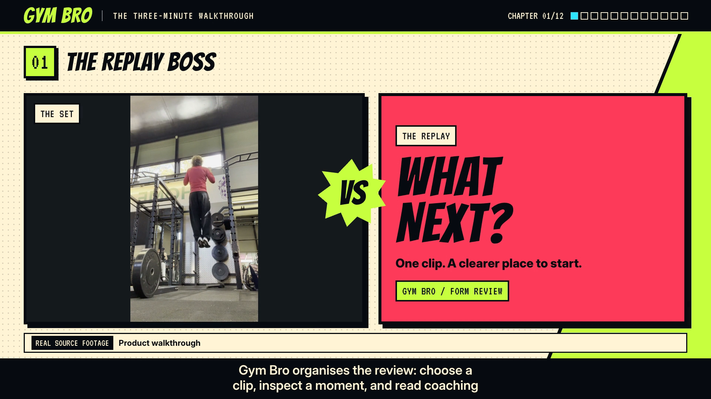
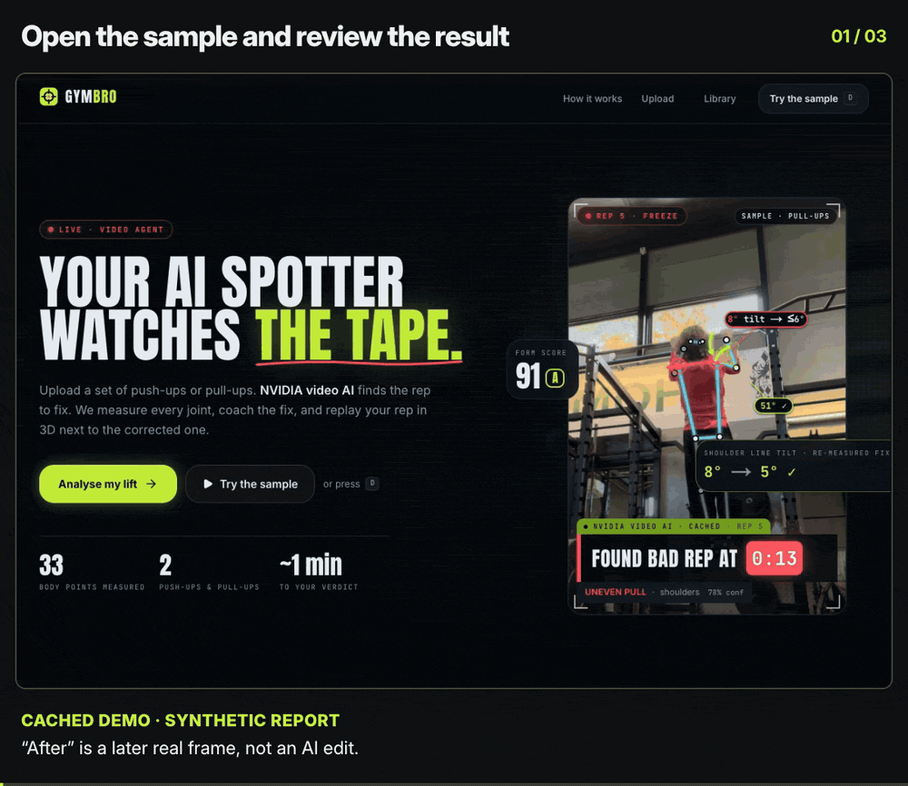
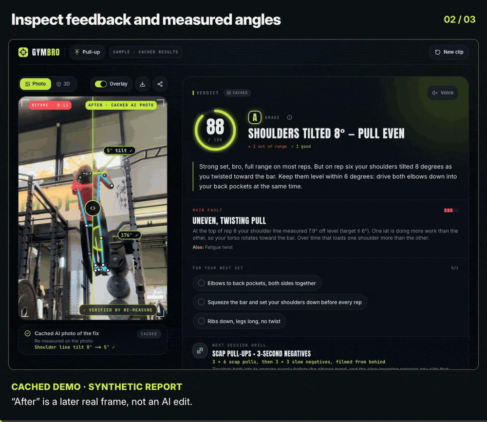
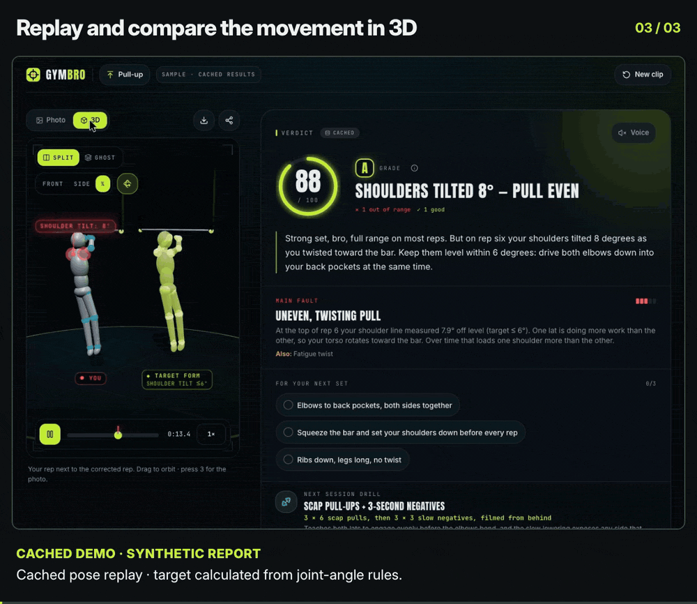
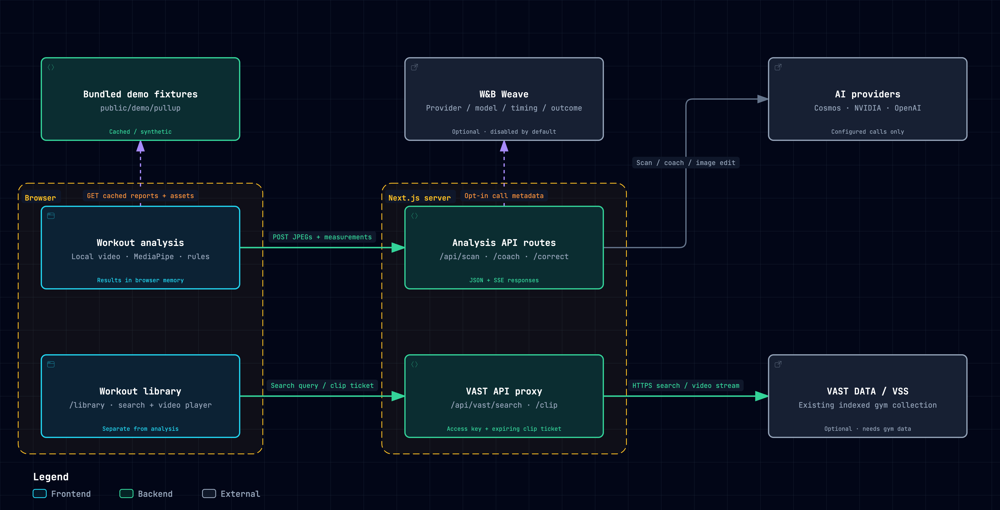

# Gym Bro: your AI spotter watches the tape

> Upload a set. **NVIDIA Cosmos** finds the bad rep. **MediaPipe** measures every joint. **GPT** coaches the fix with your real angles. **GPT Image** shows you doing it right, and then we **re-measure** the corrected image to verify it.

Built for the VAST Builders Challenge, "Real-Time Video Agents Hack – LDN" (17 Oct 2026).

```
Watch (Cosmos) → Measure (MediaPipe) → Coach (GPT) → Show (GPT Image) → Verify (MediaPipe again)
```

## Three-minute walkthrough

[](docs/media/gymbro-3-minute.mp4)

[Watch the three-minute walkthrough](docs/media/gymbro-3-minute.mp4) (1080p MP4, 23.5 MB) · [Download captions](docs/media/gymbro-3-minute.vtt?raw=true)

Follow the cached pull-up demo, then see the optional VAST workout library and W&B Weave tracing. The analysis shown is a saved synthetic example. Live sponsor services still need configuration; CoreWeave hosting is a proposed next step.

## Product in use

These short loops show the current interface using the bundled pull-up example. They are edited screen recordings with cached reports and timings. The comparison's “after” image is a later real frame from the same clip, not an AI edit; the 3D target is calculated from joint-angle rules.

### Open the sample

Start the cached analysis and follow it through to the result.



[MP4 version](docs/media/gymbro-demo-flow.mp4)

### Inspect the result

Drag the comparison slider, toggle the pose overlay, and inspect measured angles and checks that need a clearer camera view.



[MP4 version](docs/media/gymbro-results-inspection.mp4)

### Explore the 3D replay

Switch from split view to ghost view, choose a side camera, slow the replay and pause it. The target illustrates the app's rules; it is not a recording of an improved rep.



[MP4 version](docs/media/gymbro-3d-replay.mp4)

## Sponsor integrations

| Sponsor technology | Role in Gym Bro | Current status |
|---|---|---|
| VAST DATA | Search an existing indexed workout collection and play matching clips from `/library` | Implemented and disabled by default. Live retrieval and playback still need gym data, credentials and verification. |
| Weights & Biases Weave | Record provider, model, duration and outcome for scan attempts, coaching and image correction | Implemented and opt-in. Live trace readback is still pending. |
| CoreWeave GPU hosting | A possible host for the Cosmos inference service | Proposed. No GPU deployment has been provisioned. |

VAST requires a separate team access key and an indexed gym collection. Analysis uploads are not indexed automatically. Enable it with `VAST_ENABLED=1` after configuring the [VAST settings](docs/sponsor-integrations.md#vast-workout-library).

Weave tracing is off by default. Enable it with `WEAVE_ENABLED=1`, `WANDB_API_KEY` and `WEAVE_PROJECT=entity/project`; see the [Weave settings](docs/sponsor-integrations.md#wb-weave). Traces exclude images, prompts, coach text and search queries. Export failures do not fail the analysis.

```bash
npm run eval:sponsors             # offline synthetic contract and privacy checks
```

The code and mocked tests do not establish live service connectivity or exercise-analysis accuracy. See the [live verification checklist](docs/sponsor-integrations.md#local-evaluation-and-live-acceptance) and [proposed CoreWeave deployment](docs/sponsor-integrations.md#coreweave-deployment-suggestion) for the remaining work.

## Integration map

[](docs/diagrams/gymbro.architecture-preview.png)

[Download the interactive map](docs/diagrams/gymbro.architecture.html?raw=true) and open it in a browser to search components and trace connections. The map describes the implemented connections; it does not indicate live service availability. CoreWeave GPU hosting is marked as proposed.

Read the [full system architecture](ARCHITECTURE.md) for component details, data flows, deployment, security and design decisions. The [editable map source](docs/diagrams/gymbro.architecture.json) and [validation receipt](docs/diagrams/gymbro.architecture.receipt.json) are included.

## Quick start

```bash
npm install            # also copies the MediaPipe wasm + downloads the pose models into public/
cp .env.example .env.local
npm run dev            # http://localhost:3000
```

With **no keys at all** the app still works end to end:
- The sample clip (or `D` on the landing page, or `/analyze?demo=pullup`) runs the cached demo pipeline with the same animations.
- Uploads fall back to an on-device pose scan, a rule-based coach, and a ghost target skeleton instead of a generated image.

## Environment variables

| Variable | Needed for | Notes |
|---|---|---|
| `OPENAI_API_KEY` | Coach, corrected image, GPT-vision scan fallback | Models: `OPENAI_COACH_MODEL` (default `gpt-6.1-sol`), `OPENAI_IMAGE_MODEL` (`gpt-image-2.5-flare`) |
| `NVIDIA_API_KEY` | Hosted Nemotron-3-Nano-Omni video scan (fallback #2) | Free key from build.nvidia.com (`nvapi-…`) |
| `COSMOS_BASE_URL` / `COSMOS_API_KEY` | **Cosmos 3 Reasoner** scan (primary) | Hackathon `COSMOS3_REASON_URL` and `GPU_BEARER_TOKEN`, or a self-hosted NIM at `http://localhost:8000`. The model is auto-discovered via `/v1/models` |
| `COSMOS_INPUT_MODE` | | `video_frames` (default) · `video_url` · `image_frames`. A 400/422 on `video_frames` auto-retries in `image_frames` |
| `DEMO_MODE=1` | Kiosk mode | Analysis API routes return fixtures; VAST remains separately configured |
| `MOCK_AI=1` | Tests | Same as `DEMO_MODE` for the routes; used by Playwright |

See `.env.example` for timeouts and the remaining options. Check what is configured at `GET /api/health`, and probe live reachability with `GET /api/health?probe=1`.

## How it works

| Step | Where | What |
|---|---|---|
| 1. Probe + sample | Browser | Up to 40 frames at 4 fps, 448 px, with the timestamp **burned into each frame** (`t=1.25s`) so the video model's timestamps are grounded |
| 2. Scan | `/api/scan` | Provider chain **Cosmos → Nemotron Omni → GPT vision contact sheet**, then an on-device pose-only scan. Every attempt is traced |
| 3. Pick + refine | Browser | Picks the single clearest fault, then refines it with pose at 10 fps across ±0.6 s to land on the exact frame (e.g. the top of the rep) |
| 4. Measure | Browser | MediaPipe Pose (heavy) on the full-res frame, then a person-centred crop, joint angles, rule verdicts and a form score |
| 5. Coach ∥ Correct | `/api/coach` (SSE) ∥ `/api/correct` | Streaming GPT coach that must quote the measured angles; GPT Image edit that keeps the identity and scene and changes only the form |
| 6. Verify | Browser | Pose on the AFTER image, re-measure, ✓ chips. If the result is off target, it regenerates once with the measured miss |

Payloads are always downscaled JPEG frames (well under Vercel's 4.5 MB body limit). Uploaded analysis video stays in the browser. The optional workout library plays existing VAST-hosted clips through a server proxy.

## Scripts

| Command | What |
|---|---|
| `npm run dev` / `build` / `start` | Next.js |
| `npm run typecheck` · `lint` · `test` · `test:e2e` | Quality gates (Vitest unit + integration; Playwright e2e in Google Chrome) |
| `npm run prep-video -- IMG_0618.MOV out.mp4 4 15` | Converts an iPhone HEVC `.MOV` into a browser-safe H.264 MP4 (start 4 s, 15 s long) |
| `npm run record-demo` | Declared fixture-recording command; the referenced `scripts/record-demo.ts` is missing from this checkout |

## Demo day checklist

1. Fill in `.env.local` (the Cosmos URL and token arrive at the 9:00 keynote), then open `/api/health?probe=1`.
2. Run a real clip end to end and note the step timings.
3. Keep the cached example labelled as synthetic. Restore the missing demo recorder before using it to replace fixtures with verified live outputs.
4. Present from `npm run build && npm run start` on the laptop. The Vercel URL is the backup.
5. If the Wi-Fi dies, press **D** on the landing page to run the cached pipeline.
6. Keep a 90-second screen recording of the full flow as the last resort.

**Keyboard:** `D` runs the demo (landing page), and `S` toggles the skeleton and angles (results).

## Notes

- **iPhone clips:** iPhone `.MOV` files are often HEVC, which desktop Chrome may not decode. Use Safari, or `npm run prep-video`.
- **Accuracy:** angles are coaching estimates from single-camera pose (typical error is 2–11°), not clinical measurements. The squat and bench targets cite literature; the deadlift, OHP, curl and pull-up thresholds are coaching heuristics and are labelled that way in the UI.
