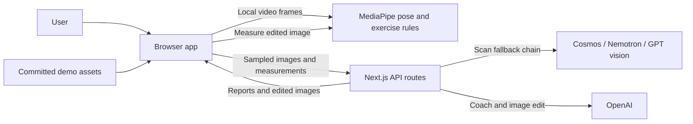
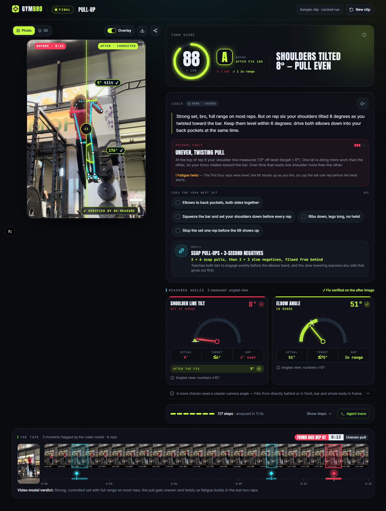
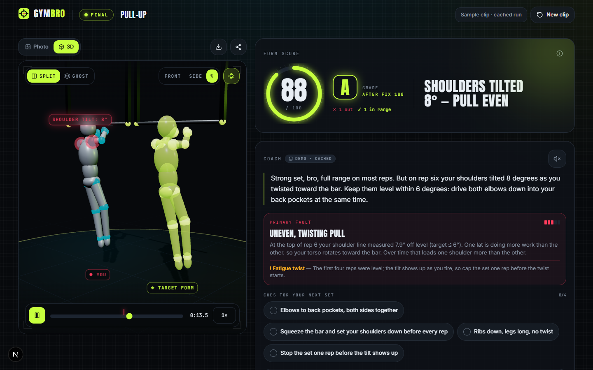

# Gym Bro

Upload a set, find a form issue and compare it with a suggested correction.

Gym Bro is a workout video analysis prototype for people reviewing their lifting technique. It combines a video model's assessment with joint measurements from MediaPipe, then uses those measurements to produce coaching cues and an illustrative image correction. The browser measures the resulting image again to check the primary target.

Built for the VAST Builders Challenge, "Real-Time Video Agents Hack - LDN", on 17 October 2026. It analyses uploaded clips rather than a live camera feed.

## Table of contents

- [Features](#features)
- [Tech stack](#tech-stack)
- [Architecture overview](#architecture-overview)
- [Installation](#installation)
- [Usage](#usage)
- [Configuration](#configuration)
- [Screenshots and demo](#screenshots-and-demo)
- [API and CLI reference](#api-and-cli-reference)
- [Tests](#tests)
- [Limitations](#limitations)
- [Contributing](#contributing)
- [Licence](#licence)
- [Contact and support](#contact-and-support)

## Features

- Analysis for pull-ups, back squats, bench presses, deadlifts, overhead presses and biceps curls.
- Timestamped frame sampling and a scan fallback chain: Cosmos, NVIDIA Nemotron Omni, GPT vision, then local pose analysis.
- MediaPipe pose measurements, exercise rules, a form score and coaching cues tied to the measured angles.
- Streaming coaching, optional spoken summaries and image editing with a second pose measurement to check the primary correction.
- A before/after slider, skeleton overlays, flagged moments, provider traces and PNG export.
- Interactive 3D pose replay with split and ghost views. The target skeleton comes from exercise rules.
- A cached pull-up demo and local fallbacks for uploads when AI services are unavailable.

## Tech stack

| Area | Technologies |
| --- | --- |
| App and server | Next.js App Router, React, TypeScript, Node.js route handlers |
| Interface | Tailwind CSS, Base UI, shadcn, Motion, Zustand |
| Pose and 3D | MediaPipe Tasks Vision, Three.js, React Three Fiber, Drei |
| AI integrations | Cosmos-compatible endpoint, NVIDIA Nemotron Omni, OpenAI Responses and Images APIs |
| Validation and testing | Zod, Vitest, Testing Library, Playwright, ESLint |

The repository pins dependency versions in [package.json](package.json) and [package-lock.json](package-lock.json).

## Architecture overview



The browser decodes the clip, samples timestamped frames, refines the selected moment and measures pose locally. Next.js routes call the configured AI services; the browser then compares the edited image with the primary target. Results live in browser memory, while committed files supply the cached demo; the app has no database or saved session history.

In the standard upload flow, the original video stays in the browser. Live analysis sends sampled JPEG frames or a contact sheet, a cropped still and pose measurements to the server and relevant AI providers. This does not describe those providers' retention policies. MediaPipe can also fetch model and WASM files from Google and jsDelivr if local assets fail to load.

## Installation

You need Git, npm and a Node.js version compatible with the locked development dependencies: Node 22.22.2+ within 22.x, 24.15.0+ within 24.x, or 26+. Google Chrome is required for the browser tests. Install FFmpeg if you want to convert phone videos or run the upload and error browser tests.

```bash
git clone https://github.com/Aerovity/Gymbro.git
cd Gymbro
npm ci
cp .env.example .env.local
npm run dev
```

Open [localhost:3000](http://localhost:3000). You can leave the API keys blank to try the demo or local upload analysis.

The install script copies MediaPipe WASM into `public/mediapipe/wasm` and downloads any missing heavy and lite pose models into `public/models`. These assets are also included in the repository. A failed model download produces a warning; check the local assets before relying on pose analysis without internet access.

## Usage

### Try the cached demo

Choose the sample clip on the landing page, press `D`, or open [the pull-up demo](http://localhost:3000/analyze?demo=pullup). This uses committed fixtures and needs no API keys.

### Analyse your own clip

1. Choose the exercise before uploading. Explicit selection is particularly useful without a remote scan provider: automatic selection falls back to pull-up in that case.
2. Upload an MP4, MOV, M4V or WebM file that your browser can decode, with the relevant joints visible. Clips must be no longer than 60 seconds and no larger than 200 MiB. Selecting a file starts analysis.
3. Review the flagged moment, measured angles and coaching cues. Use `S` to toggle the skeleton and angles, or `3` to toggle the 3D view.
4. Compare the suggested correction and inspect the provider trace to see which services or fallbacks ran.

| Exercise | Suggested camera position |
| --- | --- |
| Pull-up | Directly in front or behind, with the bar and whole body visible |
| Back squat | Side view at hip height, with the whole body visible |
| Bench press | Foot end at about 45 degrees, with the bar and both elbows visible |
| Deadlift | Side view, with the bar and whole body visible |
| Overhead press | Side view, with the bar and whole body visible |
| Biceps curl | Side view, with the upper body and elbows visible |

Without working AI services, uploads use local pose analysis, rule-based coaching and a target ghost skeleton. The ghost does not go through generated-image verification.

For an iPhone HEVC clip that Chrome cannot decode, try Safari or convert it with FFmpeg:

```bash
npm run prep-video -- IMG_0618.MOV out.mp4 4 15
```

This starts at 4 seconds and exports a 15-second H.264 clip without audio. The command overwrites an existing output file.

### Run a production build locally

```bash
npm run build
npm run start
```

## Configuration

Edit `.env.local`, using [.env.example](.env.example) as the reference. Keep credentials on the server and out of commits. Restart the server after changing them.

| Variable | Purpose |
| --- | --- |
| `COSMOS_BASE_URL` | Primary scan endpoint. Use the hackathon endpoint or a compatible self-hosted service. |
| `COSMOS_API_KEY` | Bearer token for that endpoint; leave blank if the local service requires none. |
| `COSMOS_MODEL` | Model ID; blank triggers discovery through `/v1/models`. |
| `COSMOS_INPUT_MODE` | `video_frames` by default; also accepts `video_url` or `image_frames`. A rejected `video_frames` request can retry with image frames. |
| `NVIDIA_API_KEY` | Enables the hosted Nemotron Omni scan fallback. |
| `NVIDIA_BASE_URL`, `NEMOTRON_MODEL` | Override the hosted endpoint or model. |
| `OPENAI_API_KEY` | Enables GPT vision fallback, streaming coaching and corrected-image generation. |
| `OPENAI_COACH_MODEL`, `OPENAI_PICK_MODEL` | Repository defaults: `gpt-6.1-sol` for coaching and frame selection. |
| `OPENAI_IMAGE_MODEL`, `OPENAI_IMAGE_QUALITY` | Repository defaults: `gpt-image-2.5-flare` and `medium`. |
| `OPENAI_IMAGE_INPUT_FIDELITY` | Leave blank unless the selected image model supports the setting. |
| `OPENAI_TTS_MODEL`, `OPENAI_TTS_VOICE` | Optional server speech. A blank model uses browser speech synthesis. |
| `DEMO_MODE=1` | Substitutes cached pull-up responses in the AI analysis routes. |
| `MOCK_AI=1` | Uses the same route fixtures; used by browser tests. |

The example file also lists frame-rate and timeout settings. Model names above are configuration defaults, not confirmation that your provider account can access them.

Use the sample demo URL for cached playback. Keep both flags at `0` when analysing your own clip: mocked routes return pull-up fixtures even for other uploads.

`GET /api/health` reports mode and configuration flags. `GET /api/health?probe=1` also probes the configured Cosmos model list and OpenAI coach model. It does not test Nemotron, image editing, speech or a complete analysis run.

## Screenshots and demo

The screenshots below show the cached pull-up demo. Its [metadata](public/demo/pullup/meta.json) identifies it as a synthetic cached run built around a real clip. The before frame and pose come from MediaPipe; the after image is a later frame from the same video used as a placeholder for an image-model edit. Demo playback does not establish that live providers ran or generated the correction.





The repository does not list a public deployment URL.

## API and CLI reference

The web app uses these Next.js routes. Request schemas are in [src/lib/schemas.ts](src/lib/schemas.ts), with browser helpers in [src/lib/api/client.ts](src/lib/api/client.ts).

| Method | Route | Purpose |
| --- | --- | --- |
| `GET` | `/api/health` | Mode and provider configuration; optional `?probe=1` reachability checks |
| `POST` | `/api/scan` | Timestamped frames to scan events and provider trace |
| `POST` | `/api/pick-frame` | GPT vision analysis of a contact sheet and timestamps |
| `POST` | `/api/coach` | Measurements and a still image to an SSE coaching stream (`delta`, `done`, `error`) |
| `POST` | `/api/correct` | Original still and target pose to an edited image |
| `POST` | `/api/tts` | Coaching text to MP3; returns `501` when server speech is unavailable |

Check a local server:

```bash
curl http://localhost:3000/api/health
curl 'http://localhost:3000/api/health?probe=1'
```

POST routes accept JSON and enforce a 4.4 MiB body cap. Validation errors return an `error` object with `code` and `message`; scan failures can also include a provider trace. The video conversion command in [Usage](#usage) is a development utility; the project has no separate analysis CLI.

## Tests

```bash
npm run typecheck
npm run lint
npm test
npm run test:cov
npm run test:e2e
```

Vitest covers unit and route integration tests. Use `npm run test:watch` while developing. Playwright builds and starts a production server on port 3210, then runs desktop Chrome and selected mobile-emulation tests with mocked AI routes. Install Google Chrome first; upload and error suites skip when FFmpeg is missing.

Mocked tests check application behaviour without proving that live model credentials, provider access or generated corrections work.

## Limitations

- Pose measurements depend on camera angle, joint visibility and the selected movement phase. Several exercise targets are coaching heuristics, and some measurements use proxies such as wrist position for bar path. The app does not provide clinical measurements.
- The displayed form score combines angle-based penalties with a coach adjustment when a remote report is available.
- Generated-image verification checks one primary metric for reliability and a tolerance of 10 degree-equivalents. A failed first check can trigger one regeneration if the initial edit took less than 45 seconds. Passing this check does not establish correct whole-body form or preserved identity.
- The 3D target is a rule-derived visualisation, not a recording of the user performing corrected movement.
- `package.json` defines `record-demo`, but its target, `scripts/record-demo.ts`, is missing. The command cannot currently refresh the bundled fixtures.

## Contributing

Open an [issue](https://github.com/Aerovity/Gymbro/issues) to report a bug or discuss a change, then submit a focused pull request. Include reproduction steps for bugs and screenshots for interface changes. Run the relevant checks above and describe whether you tested with fixtures, local fallbacks or live providers.

[docs/BUILD.md](docs/BUILD.md) explains the implementation layout, and [docs/SPEC.md](docs/SPEC.md) records the design specification. Check the source for current behaviour where those documents describe planned work.

## Licence

The repository does not include a licence file or declare a licence in `package.json`. No licence has been specified; ask the maintainer about permission to reuse or distribute the code.

## Contact and support

Use [GitHub issues](https://github.com/Aerovity/Gymbro/issues) for project support. The repository owner is [Aerovity](https://github.com/Aerovity).
