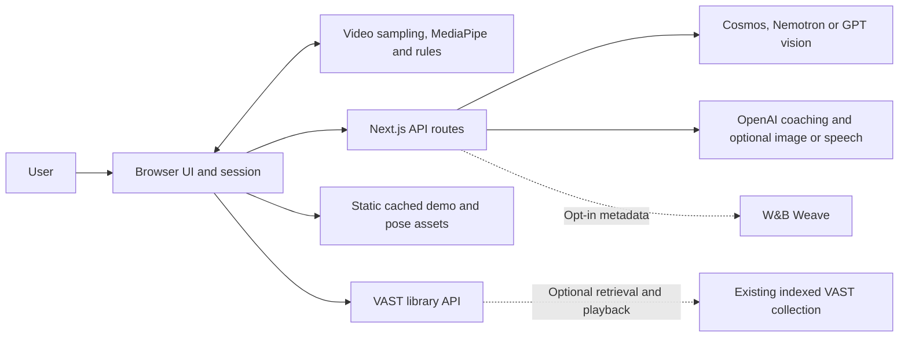

# Gym Bro

Review a workout clip, inspect measured form and get targeted coaching.

## Description

Gym Bro is a browser-based exercise review prototype built for the VAST Builders Challenge, **Real-Time Video Agents Hack – LDN**, on 17 October 2026. It helps people reviewing their own training footage connect coaching to a specific rep, visible pose landmarks and measured joint angles. The current interface offers **push-ups and pull-ups**.

The main flow is **upload → scan → select a moment → measure pose → coach**. Users can inspect a target skeleton and 3D replay, then optionally request an AI photo illustrating the fix. A cached pull-up example works without provider keys. Optional VAST DATA retrieval and W&B Weave tracing need configuration and live acceptance checks; CoreWeave GPU hosting remains proposed.

## Table of Contents

- [Description](#description)
- [Features](#features)
- [Tech Stack](#tech-stack)
- [Architecture Overview](#architecture-overview)
- [Installation](#installation)
- [Usage](#usage)
- [Configuration](#configuration)
- [Screenshots / Demo](#screenshots--demo)
- [API / CLI Reference](#api--cli-reference)
- [Tests](#tests)
- [Roadmap](#roadmap)
- [Contributing](#contributing)
- [Licence](#licence)
- [Contact / Support](#contact--support)

## Features

- Sample timestamped frames and try configured scan providers in order: NVIDIA Cosmos, NVIDIA Nemotron and GPT vision, with a browser pose fallback.
- Select and refine a rep, estimate pose with MediaPipe, and show joint measurements, reliability labels and rule-based targets.
- Stream coaching linked to the measured frame; use local rule-based tips when the AI coach is unavailable.
- Inspect the filmstrip, steps, provider labels and trace in **Under the hood**, shown above the verdict and expanded by default.
- Compare measured and target form in a Three.js replay. Optionally generate an AI photo and remeasure its primary metric, with separate generation and verification states.
- Export a result image through download, clipboard or the device's share interface. No public result page or saved account history is created.
- Search an existing indexed workout collection through optional VAST retrieval and expiring playback links.
- Export allowlisted operation metadata through optional W&B Weave tracing.

Measurements and image checks are single-camera estimates, not clinical measurements or proof of safe exercise. Cached outputs and synthetic timings must be distinguished from fresh analysis.

## Tech Stack

| Area | Technologies |
| --- | --- |
| Web application | Next.js 16.4.2 App Router, React 19.3.0, TypeScript |
| Interface and state | Tailwind CSS, Motion, Zustand, Base UI |
| Video and pose | Browser video/canvas APIs, MediaPipe Tasks Vision, WebAssembly |
| 3D replay | Three.js, React Three Fiber, Drei |
| API contracts | Next.js Node.js route handlers and Zod |
| Optional AI providers | NVIDIA Cosmos/Nemotron; OpenAI vision, coaching, image editing and speech |
| Optional sponsor services | VAST VSS search/playback; W&B Weave Service API |
| Checks | Vitest, Testing Library, Playwright, ESLint, TypeScript |

Versions are declared in [`package.json`](package.json). The app has no application database, job queue or account service; session state is held in browser memory.

## Architecture Overview



The browser owns the active session, video decoding, pose estimation, measurements and visualisation; server routes hold provider credentials and adapt external services. Normal analysis keeps the video file in the browser but sends selected images and context to configured providers. Static fixtures and an external VAST collection serve different purposes; the app does not persist analysis sessions or ingest uploaded clips into VAST.

See [`ARCHITECTURE.md`](ARCHITECTURE.md) for component responsibilities, data flows, security boundaries and deployment limits.

## Installation

### Requirements

- Git, npm and a supported Node.js runtime. **Node.js 24.x** is a suitable starting point for the declared dependency requirements; no runtime version is pinned. The locked Vitest version requires Node.js `^22.12.0`, `^24.0.0` or `>=26.0.0`.
- A modern browser with WebAssembly and WebGL support. Video decoding depends on the browser and codec.
- Internet access for dependency and pose-model downloads. Provider keys are optional for the cached example.
- Optional: Google Chrome for the configured Playwright projects; `ffmpeg` for phone-video conversion.

### Set up a local checkout

```sh
git clone https://github.com/Aerovity/Gymbro.git
cd Gymbro
npm ci
cp .env.example .env.local
npm run dev
```

Open <http://localhost:3000/>. Leave provider credentials blank to try the cached sample first. Keep real keys in `.env.local` or deployment secret settings; environment files are ignored apart from `.env.example`.

The install hook copies MediaPipe WebAssembly files into `public/mediapipe/wasm` and downloads heavy/lite pose models into `public/models`. If model downloads fail, the browser can try remote assets; offline use is not guaranteed on a fresh device. Repeat asset preparation after resolving a download problem with:

```sh
npm run postinstall
```

## Usage

### Run the cached example

Visit <http://localhost:3000/analyze?demo=pullup>, choose the landing-page sample, or press **D** on the landing page. This loads saved scan, coaching and pose fixtures without new inference. The after image is a later real frame from the same clip, not a generated correction; see [`meta.json`](public/demo/pullup/meta.json).

### Review a new clip

1. Upload an MP4, MOV, M4V or WebM clip, up to **200 MiB and 60 seconds**. A short, clear view of the whole body is preferable; codec support still applies.
2. Select push-up, pull-up or automatic detection, and inspect the detected exercise. Inconclusive classification can present a low-confidence push-up choice for confirmation.
3. Review the chosen frame, angles, coaching and target form. Inspect **Under the hood** and **Agent trace** for provider attempts and fallbacks.
4. Optionally choose **Generate AI photo of the fix**. This separate request uses the available coaching target, then measures the returned image. A failed measurement does not trigger an automatic second image edit; retry or regenerate manually if needed.
5. Explore the 3D replay or export a result image. Press **S** to toggle the skeleton; **3** switches the photo/3D view when replay is available.

Without AI keys, uploads can use browser pose scanning and rule-based coaching; optional AI photo generation remains unavailable. Failed pose estimation can produce an error rather than a complete review. Selecting another moment or correcting the exercise reruns the relevant analysis. Reloading discards the active session.

For an iPhone clip that the browser cannot decode, convert it with `ffmpeg` installed:

```sh
npm run prep-video -- input.MOV prepared.mp4 4 15
```

This writes a browser-friendly H.264 MP4 beginning at four seconds, with a 15-second duration. The conversion script overwrites its output path.

### Run a production build locally

```sh
npm run build
npm start
```

Choose hosting that supports the Node.js API routes, streaming coaching and their execution budgets. This source supplies no reproducible hosted deployment or CoreWeave GPU provisioning. General analysis routes have no application-level sign-in or rate limit; review the [security boundaries](ARCHITECTURE.md#security--compliance) before public use.

## Configuration

Copy [`.env.example`](.env.example) and restart the server after changing settings. Model identifiers are configuration defaults, not a statement that an account can access those models.

| Settings | Purpose and default behaviour |
| --- | --- |
| `DEMO_MODE`, `MOCK_AI` | Default `0`. Either enabled flag makes analysis API routes use fixtures; VAST remains independently configured. |
| `COSMOS_BASE_URL`, `COSMOS_API_KEY`, `COSMOS_MODEL` | Optional primary video scan. An empty model enables discovery. Use the inference endpoint, separately from VAST retrieval. |
| `COSMOS_INPUT_MODE`, `COSMOS_TIMEOUT_MS` | Defaults `video_frames` and `35000`; further options are in `.env.example`. |
| `NVIDIA_API_KEY`, `NVIDIA_BASE_URL`, `NEMOTRON_MODEL` | Optional hosted Nemotron fallback; endpoint and model are in `.env.example`. |
| `OPENAI_API_KEY`, `OPENAI_COACH_MODEL`, `OPENAI_PICK_MODEL` | Coaching and GPT vision. Coach/pick defaults are `gpt-6.1-sol`. |
| `OPENAI_IMAGE_MODEL`, `OPENAI_IMAGE_QUALITY` | Optional photo edit; defaults `gpt-image-2.5-flare` and `medium`. |
| `OPENAI_TTS_MODEL`, `OPENAI_TTS_VOICE` | Optional spoken coaching. A blank TTS model uses browser speech synthesis; server voice default `onyx`. |
| `VAST_ENABLED`, `VAST_BASE_URL`, `VAST_WORKOUT_TAG`, `VAST_APP_ACCESS_KEY` | Library disabled by default. Requires an existing indexed collection and a separate 32–512 character team key. |
| `VAST_BEARER_TOKEN` or `VAST_USERNAME` / `VAST_PASSWORD` | Server-side VSS credentials. Do not use these as the team key. HTTPS is the default endpoint policy. |
| `WEAVE_ENABLED`, `WANDB_API_KEY`, `WEAVE_PROJECT` | Tracing disabled by default. Project format `entity/project`; excludes images, prompts, coach text and search queries. |
| `WEAVE_TRACE_BASE_URL`, `WEAVE_TIMEOUT_MS` | Defaults `https://trace.wandb.ai` and a 750 ms total export deadline. |

`YOLO_URL` is reserved configuration, not a connected YOLO detector. `NEXT_DIST_DIR` optionally selects a separate build directory. The [sponsor integration guide](docs/sponsor-integrations.md) covers setup, access controls, synthetic checks and live acceptance. Live VAST retrieval/playback and Weave readback remain pending; CoreWeave hosting is proposed.

## Screenshots / Demo

[](docs/media/gymbro-3-minute.mp4)

- [Three-minute walkthrough](docs/media/gymbro-3-minute.mp4), 1080p MP4, with [captions](docs/media/gymbro-3-minute.vtt?raw=true). It demonstrates a cached synthetic example and introduces optional sponsor services, without proving live inference.
- [Saved desktop results capture](docs/screens/results-desktop.png) and [mobile 3D replay capture](docs/screens/3d-replay-mobile.png). These are saved captures; the current layout may differ.
- [Repository-listed website](https://gymbro-gold.vercel.app). Deployment availability, version and provider connectivity have not been verified by this documentation update.
- [Earlier interactive architecture map](docs/diagrams/gymbro.architecture.html?raw=true), [preview](docs/diagrams/gymbro.architecture-preview.png) and [editable source](docs/diagrams/gymbro.architecture.json). Download the HTML and open it locally. These artifacts predate the current on-demand photo flow; use `ARCHITECTURE.md` for the current workflow.

## API / CLI Reference

These are internal application routes, not a versioned public API. Contracts are in [`src/lib/schemas.ts`](src/lib/schemas.ts), with separate [VAST response types](src/lib/vast/types.ts).

| Method and route | Purpose |
| --- | --- |
| `GET /api/health` | Configuration flags; `?probe=1` checks Cosmos discovery and OpenAI model metadata, without inference. |
| `POST /api/scan` | Exercise, duration, sampling rate and up to 40 timestamped frames; returns events and attempt traces. |
| `POST /api/coach` | Measured context and selected frame; streams SSE `delta`, `done` or `error` events. |
| `POST /api/correct` | Image, exercise, edit size and correction target; returns an image data URL and model metadata. |
| `POST /api/pick-frame` | Standalone contact-sheet selection; normal analysis uses the scan chain. |
| `POST /api/tts` | Optional speech generation for the coaching summary. |
| `GET /api/vast/status` | Library enablement/configuration, without a live probe. |
| `POST /api/vast/search` | `{ "query": "side view of a pull-up", "limit": 5 }`; requires the team key in `x-vast-access-key`. |
| `GET /api/vast/clip?ticket=...` | Bounded playback through an opaque ticket expiring after ten minutes. |

Example with the local server running:

```sh
curl --fail-with-body http://localhost:3000/api/health
```

A healthy response reports configuration, not successful analysis or sponsor connectivity. Common errors use `{ "error": { "code": "...", "message": "..." } }`. VAST search accepts 3–500 characters and 1–10 results; missing configuration returns `503`, and an incorrect team key returns `401` once configured.

`npm run record-demo` is declared, but its referenced `scripts/record-demo.ts` is missing. It cannot currently regenerate the cached fixtures.

## Tests

```sh
npm run typecheck
npm run lint
npm test
npm run eval:sponsors
```

Vitest covers unit/integration contracts, measurements, selection, fixtures, mocked routes, the library and telemetry policy. `npm run test:cov` adds V8 coverage. Sponsor evaluation checks synthetic policy behaviour, without inference calls or exercise-accuracy measurement. Export is separately opt-in through `npm run eval:sponsors -- --export`, with approved Weave settings in that process's environment; the command does not automatically load `.env.local`.

For browser checks, install the Chrome channel if unavailable, then run:

```sh
npx playwright install chrome
npm run test:e2e
```

Playwright builds/starts a mock-AI instance, normally on port 3210 with `.next-e2e` output. Chrome is selected for H.264 support; these tests do not verify live providers. Installing the Chrome channel affects the local browser installation. No test pass count or live acceptance result is asserted by this documentation update.

## Roadmap

Proposed work, with no committed delivery schedule:

- Verify VAST retrieval/playback against a permitted gym collection and inspect real Weave exports.
- Evaluate Cosmos hosting on CoreWeave, including model compatibility, latency and cost.
- Add access controls and cost limits before opening paid analysis routes to a wider audience.
- Evaluate pose/rule accuracy and measurement coverage against labelled clips.
- Restore the fixture recorder and refresh the earlier map, screenshots and film for the current flow.

The [architecture roadmap](ARCHITECTURE.md#future-improvements) covers further deployment, privacy, observability and reliability work.

## Contributing

Use [GitHub Issues](https://github.com/Aerovity/Gymbro/issues) to report a reproducible problem or discuss a change. Create a branch or fork and submit a pull request to [Aerovity/Gymbro](https://github.com/Aerovity/Gymbro), describing the behaviour changed and checks performed.

Keep credentials and identifiable test footage out of commits. Preserve fixture provenance and distinguish cached examples, mocked checks and live evidence. For application changes, run the relevant checks above and document any that could not be completed. No separate contribution guide or contributor licence agreement is supplied.

## Licence

The repository does not currently declare a project licence or include a root `LICENSE` file. Reuse terms need maintainer clarification; dependencies and model assets have their own terms.

## Contact / Support

- Project: [Aerovity/Gymbro](https://github.com/Aerovity/Gymbro).
- Bug reports and project questions: [GitHub Issues](https://github.com/Aerovity/Gymbro/issues).
- Maintainer profile: [Aerovity](https://github.com/Aerovity). No dedicated support email is listed in the repository.
