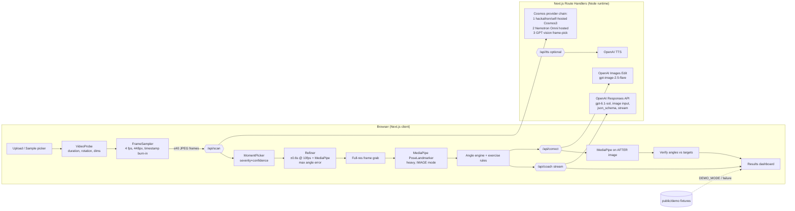

# Gym Bro — Implementation-Ready Build Plan for Claude Code (VAST London "Real-Time Video Agents Hack")

Build Gym Bro as a single Next.js 16.4 App Router app: NVIDIA Cosmos 3 Reasoner (the event's own video model) finds the bad rep, MediaPipe Pose Landmarker measures it in the browser, GPT-6.1 Sol coaches with real angles, and GPT-Image-2.5 Flare draws the corrected form. Expect NVIDIA's hosted Cosmos API to be unavailable, so use a three-tier video-scan fallback and a demo mode that can't break.

## TL;DR

- **The event is a video-agents hackathon built around NVIDIA Cosmos.** "Real-Time Video Agents Hack – LDN" (VAST Builders Challenge) runs on 17 October 2026: build 9:30am, demos 4:30pm, awards 6:30pm. Its stack lists "Video understanding: reason over a video clip with NVIDIA Cosmos", plus semantic search, YOLO and Weights & Biases LLMs. First prize is an NVIDIA DGX Spark.\[1\]\[2\] The page publishes no judging rubric and no submission format, so pitch to the judges listed: NVIDIA, VAST Data and W&B.
- **Use the Cosmos 3 Reasoner (`nvidia/cosmos3-nano-reasoner`) through its OpenAI-compatible `/v1/chat/completions` API.** Send the clip as `video_url` or as pre-decoded `video_frames`.\[3\]\[4\] Ask for JSON timestamps at 4 fps, which gives ±0.125 s precision.\[5\] Use the per-team endpoint the hackathon hands out as the primary route.\[6\] Hosted build.nvidia.com Cosmos calls have been returning 404s, so the fallbacks are Nemotron-3-Nano-Omni on integrate.api.nvidia.com, then GPT vision over sampled frames, then cached demo results.\[7\]\[8\]
- **Keep the architecture small.** The browser does the heavy lifting: frame extraction, MediaPipe pose, angle math and overlays. Five thin route handlers hide API keys. Every payload stays under Vercel's 4.5 MB function body limit, which means sending downscaled JPEG frames, never raw video.\[9\] Claude Code must ship unit, integration and Playwright tests and run them green before finishing.

---

## 0. How to use this document (instructions to Claude Code)

You are building **Gym Bro**, an AI gym technique spotter, end to end. Follow this plan in order. Where this plan says **VERIFY**, check the live docs or SDK types before you code. Model IDs and parameters change often, and the plan was written on 12 October 2026. Do not ask the user questions. Make sensible defaults, put them in config, and keep going.

**Definition of done (do not stop before all are true):**
1. `npm run typecheck`, `npm run lint`, `npm run test` (Vitest) and `npm run test:e2e` (Playwright) all pass.
2. `npm run build` succeeds. `npm run start` serves the app, and the full demo flow works in a real browser with `DEMO_MODE=1` and no API keys.
3. With real keys in `.env.local`, the live flow works on at least one real squat clip, the steps in Section 18 have been run, and any failures are fixed or have a fallback.
4. The README explains setup, env vars, demo mode and deployment.

---

## 1. Hackathon context (researched)

### 1.1 What the event is

| Item | Finding |
|---|---|
| Name | "Real-Time Video Agents Hack – LDN", part of the **VAST Builders Challenge** (New York, London, San Francisco)\[1\] |
| Organiser | tokens& with **VAST Data**, in collaboration with **NVIDIA**, **SpaceXAI** (listed with a cursor.com link), **CoreWeave** and **Weights & Biases**\[1\] |
| Date | 17 October 2026, London (exact address shown only after approval)\[2\] |
| Agenda | 8:30 doors · 9:00 keynotes · **9:30 build begins** · 12:30 lunch · **4:30 demos** · 6:30 closing & awards\[1\] |
| Theme | "Spend the day building agents to unlock the value of video. Because video is hard to search and analyze, most of it stays in storage, unwatched and underused."\[1\] |
| Provided stack | **Video understanding:** reason over a video clip with NVIDIA Cosmos · **Semantic search** across footage · **Object detection** with YOLO · **General-purpose LLMs** from Weights & Biases. "The VAST AI OS orchestrates the video ingestion and data layer, models are served on CoreWeave GPUs, and builders ship with Cursor."\[1\] |
| Prizes | 1st place: **NVIDIA DGX Spark™**. Also listed: HuggingFace Microduck, Cursor credits, cash gift cards\[1\] |
| Judges | Abubakr Karali (Senior Solutions Architect, NVIDIA) · Ram B. (Sr. Developer Advocate, VAST Data) · Brian Verkley (Director, AI Data Platform, VAST Data) · Junaid Butt (AI Solutions Engineer, Weights & Biases)\[1\] |
| Teams | Individuals welcome; teams of up to four are encouraged and prioritised |
| Judging criteria / submission format | **Not published on the event page.** Expect a live demo slot (agenda says "4:30pm Demos"). Bring a 60–90 s backup screen recording |

**Conflicting registration deadline:** the live event page says "Registration closes on 15th October", while an earlier indexed copy said 9 October.\[1\]\[2\] Trust the live page.

### 1.2 What this means for winning

- **The judges are NVIDIA, VAST and W&B people.** Make the Cosmos step obviously load-bearing and visible in the UI. Show a "Cosmos Reason" badge, the raw timeline events it returned, and its reasoning snippet. A "GPT wrapper" pitch will lose to a "video agent" pitch.
- **Fit the theme.** Gym footage is the textbook "video that stays unwatched". Gym Bro turns a 10-second clip into a timestamped, measured, visual correction.
- **Optional sponsor touches (low effort, high signal):**
  - (a) Log every pipeline step with W&B Weave tracing. A W&B judge will notice.
  - (b) If the event hands out a VAST/CoreWeave Cosmos endpoint, use it. Mention that "the VAST AI OS serves the model on CoreWeave GPUs".
  - (c) Optionally run YOLO person-detection from the provided `YOLO_URL` to crop the lifter.

### 1.3 Which NVIDIA model and how to call it

**Model: NVIDIA Cosmos 3 Reasoner, Nano size (`nvidia/cosmos3-nano-reasoner`).** The build.nvidia.com card describes it as a "Vision language model that excels in understanding the physical world using structured reasoning on videos or images".\[10\]\[11\] It accepts "Text, Text+Image, Text+Video", with video as mp4 and "Video inputs are recommended at a frame rate of 4 fps".\[12\] It supports "Long-context inputs… up to 256K tokens".\[13\] The NIM ships as one download in two sizes: Nano (served as `nvidia/cosmos3-nano-reasoner`) and Super (served as `nvidia/cosmos3-super-reasoner`).\[4\] Note that NVIDIA's own pages disagree on parameter counts. The NIM 1.7.0 docs say "Nano (8B)… Super (32B)", while NVIDIA's Technical Blog post announcing Cosmos 3 says "Cosmos 3 Nano with 16B parameters… Cosmos 3 Super with 64B parameters". The previous generation, `nvidia/cosmos-reason2-8b` (and 2B), uses the same API shape. NVIDIA's VSS (Video Search & Summarization) blueprint also uses Cosmos Reason as its VLM.\[10\]\[14\] VSS is overkill for a 10-second clip, so call the model directly.

**Endpoint and request format.** The NIM exposes the OpenAI Chat Completions schema with a video extension:

```http
POST {COSMOS_BASE_URL}/v1/chat/completions
Authorization: Bearer {COSMOS_API_KEY}      # hackathon GPU_BEARER_TOKEN; local NIM ignores it
Content-Type: application/json
```

```json
{
  "model": "nvidia/cosmos3-nano-reasoner",
  "messages": [
    {"role": "system", "content": "<short system prompt, see §8.1>"},
    {"role": "user", "content": [
      {"type": "video_url", "video_url": {"url": "data:video/mp4;base64,AAAA..."}},
      {"type": "text", "text": "<scan prompt, see §8.1>"}
    ]}
  ],
  "max_tokens": 2048,
  "temperature": 0.2,
  "top_p": 0.3,
  "media_io_kwargs": {"video": {"fps": 4}},
  "mm_processor_kwargs": {"size": {"shortest_edge": 1568, "longest_edge": 262144}}
}
```

Key facts from the NIM docs:

- **Three ways to send video:**
  - A public URL: "Passing a direct URL prompts the container to download the video at runtime."
  - A base64 `data:video/mp4;base64,...` URL.
  - **Pre-decoded frames** with `{"type":"video_frames","video_frames":["data:image/jpeg;base64,...", ...]}`. The docs explain that, unlike separate `image_url` entries, "`video_frames` preserves temporal relationships between frames and uses fewer tokens."
- **Sampling.** Set `media_io_kwargs.video.fps` (default 4) or `num_frames`.\[4\] If both are set, the model uses whichever gives fewer frames. "Specifying values of fps or num_frames higher than the actual values for a given video will result in a 400 error code."
- **Timestamp precision.** "At 2 FPS, timestamp precision in the generated output will be at best within +/- 0.25 seconds of the true values."\[5\] So use 4 fps (±0.125 s), then refine locally with pose (§7.4).
- **Resolution and token budget.**
  - `mm_processor_kwargs.size` defaults to `shortest_edge=3136, longest_edge=12845056`.
  - For Cosmos 3, longest_edge applies "per temporal group of 2 frames", so the effective video default is 25,690,112.
  - On Reason2, each 32×32×2 patch is one token, and the model "was tested to perform best with 16k multimodal tokens or less".
- **Reasoning mode.** Append the documented `<think>…</think>` format instruction to get chain-of-thought. For speed, ask for JSON only and keep reasoning off by default. Make it a toggle.
- **Timestamp grounding.** NVIDIA's Reason model card says the model "recognizes timestamps added at the bottom of each frame for accurate temporal localization", and the Reason1 temporal-localization example uses timestamp-watermarked video. Gym Bro burns `t=1.25s` into the bottom of each extracted frame before sending `video_frames`. That trick makes the returned timestamps much more reliable.
- **Structured output.** The NIM has a "Structured Generation" feature. **VERIFY** whether your endpoint accepts `response_format: {type:"json_schema", ...}` or `guided_json`. If it doesn't, rely on prompt-enforced JSON and the tolerant parser in §7.2.

**Hosted availability: the critical risk.**

- The build.nvidia.com page labels `cosmos3-nano-reasoner` "Downloadable · Free Endpoint". It shows a browser playground: user prompt "max 1000 tokens", system prompt "Max 250 tokens". It also warns: "Free APIs for development. Your API requests may be rate limited. Traffic from other users may cause throttling."
- On the NVIDIA developer forums (February 2026), NVIDIA staff said of `cosmos-reason2-8b`: "the API and video upload feature for this model has been disabled for security reasons. You can still try using the model via the web experience… or deploying the model yourself via huggingface… or the downloadable NIM container."
- A July 2026 forum post reports that both `nvidia/cosmos-reason2-8b` and `nvidia/cosmos3-nano-reasoner` return "404 Function … Not found for account", even though other NIM models work with the same key.\[8\]
- **Assume hosted Cosmos video calls will fail.**

**What actually works, in priority order (implement all four as a provider chain):**

1. **Hackathon-provided Cosmos endpoint (primary).** A builder repo for this event series tells participants to "Set the assigned COSMOS3_REASON_URL, YOLO_URL, COSMOS_EMBED1_URL, and any required GPU_BEARER_TOKEN in .env".\[6\] So organisers hand out per-team, OpenAI-compatible Cosmos 3 Reasoner endpoints. Discover the model with `GET {URL}/v1/models`.
2. **Self-hosted NIM (if you have a ≥24 GB GPU).**
   - Run `docker run --gpus all -e NGC_API_KEY=$NGC_API_KEY -e NIM_MODEL_SIZE=nano -p 8000:8000 nvcr.io/nim/nvidia/cosmos3-reasoner:1.7.0`.\[4\]\[15\]
   - NVIDIA's Cosmos3 Reasoner cookbook puts Nano at "~16–17 GB with vLLM / TensorRT-LLM / Transformers / NIM", and NVIDIA's deployment notes list "24 GiB for Reasoner Nano BF16, 18 GiB for Reasoner Nano FP8 or NVFP4".
   - Docs note "NIM initialization may take several minutes as it compiles the model."\[4\]
3. **Hosted Nemotron-3-Nano-Omni (NVIDIA, works today).**
   - Endpoint: `https://integrate.api.nvidia.com/v1/chat/completions`, model `nvidia/nemotron-3-nano-omni-30b-a3b-reasoning`, `Authorization: Bearer $NVIDIA_API_KEY`.
   - The build page lists "Free Endpoint", "Input Modalities: Video, Audio, Image, Text" and "Context Length 262K".
   - The model card says "Video: mp4, up to 2 minutes. For 1080p videos, sample up to 1 FPS / 128 frames."\[16\]
   - Send `{"type":"video_url","video_url":{"url":"data:video/mp4;base64,…"}}` with `temperature: 0` and `chat_template_kwargs: {enable_thinking: false}`. Third-party guides say reasoning is supported only for text and image inputs.
   - Add the header `NVCF-POLL-SECONDS: 1800` for long requests.
   - NVIDIA Developer Forums threads cite a ~40 RPM free-tier cap, and a moderator reply quoted there says the limit "is dependent on model, use-case and the amount of current overall traffic… There is no official way to circumvent this rate limit".
4. **GPT vision fallback**, then **cached demo results** (§13).

**Limits and pricing (honest status).**
- No official byte limit for base64 video on integrate.api.nvidia.com was found.
- No published per-model credit allotment was found; the free endpoints are "for development" and rate-limited.\[17\]
- Latency is not documented. Budget about 5–20 s for a 10-second clip at 4 fps on the hackathon GPU endpoint, and measure it on the day.
- The real constraint is your own proxy: **Vercel caps request bodies at 4.5 MB** (§16). Always send ≤40 downscaled JPEG frames (about 0.8–1.5 MB total), not the raw phone video.

---

## 2. Product overview, goals and the demo

### 2.1 The user's vision (preserved exactly)

1. The user uploads a video of a gym set: squat, bench, deadlift, overhead press or curl.
2. The NVIDIA video model analyses it and finds the timestamps or keyframes where technique was bad.
3. Pick **one** bad moment, the clearest or most illustrative, not all of them.
4. Run an open-source pose/skeleton model on that frame to get joint coordinates and compute joint angles (shoulders, elbows, hips, knees, back/torso lean, etc.).
5. Send the frame plus the precise coordinates and angles to an OpenAI GPT vision model. It explains what's wrong (e.g. "your elbows flare to X°, should be about Y°") and gives target angles and corrections.
6. Generate a corrected "after" image with OpenAI's GPT image model. Edit the original frame so it stays the same person and scene, with correct form.
7. The UI shows:
   - a before/after comparison slider;
   - coach-style AI explanation, streamed, with optional voice;
   - a toggle to show or hide the skeleton overlay and angle annotations on both images;
   - target vs actual angles shown visually.

### 2.2 Goals

- **Reliability:** the demo can't break. Every external call has a timeout, one retry and a fallback, and demo mode works offline.
- **Wow:** a broadcast-telestrator look, a live pipeline animation, and the slider reveal with skeletons that line up.
- **Credibility:** numbers come from pose geometry, not LLM guesses. The LLM must quote the measured angles, and the "after" image is re-measured to prove it is correct.

### 2.3 Pitch angle (30 seconds)

> "90% of gym footage is filmed and never watched. Gym Bro is a video agent. **NVIDIA Cosmos watches the whole set** and finds the exact rep where your form broke, at 0:07. **MediaPipe measures you**: your elbows flared to 84°. **GPT coaches you** with those exact numbers. **GPT Image shows you** what correct looks like, as you, in your gym. Then we re-measure the corrected image to verify it: 62°, in range. Watch → measure → coach → show → verify."

### 2.4 Demo script for judges (3 minutes)

1. **(0:00) Hook.** Landing hero, one line: "Your AI spotter that actually watches the video."
2. **(0:15) Live run.** Drag in a pre-trimmed 8–12 s squat or bench clip filmed from the side. Pick the exercise chip (or let Auto-detect pick it). The pipeline animates: Uploading → Scanning video with Cosmos → "Found bad rep at 0:07" → Mapping skeleton → Coach analysing → Generating corrected form.
3. **(1:00) Results.**
   - Point at the timeline: Cosmos markers, with the chosen one pulsing.
   - Toggle the skeleton on and off.
   - Read one angle card aloud: "Knee 112°, target ≤ 95°".
   - The coach text streams while it speaks (TTS).
4. **(1:40) Reveal.** Drag the before/after slider. Toggle the skeleton on the "after" image and show its verified angles turning green.
5. **(2:10) Under the hood.** Open the "Agent trace" drawer showing the raw Cosmos JSON, the timestamps, provider and latency per step (and the W&B Weave link if it was built).
6. **(2:40) Close.** "Built on NVIDIA Cosmos and the VAST stack. Next: real-time, rep-by-rep cueing."
7. **Backup.** If the Wi-Fi dies, press `D` (or open `?demo=squat`) to run the cached pipeline with identical animations. Always have a 90 s screen recording ready too.

### 2.5 Optional ideas beyond the vision (clearly optional; build only after the core passes all tests)

- **(Optional) Rep counter and per-rep score strip.** Run MediaPipe VIDEO mode across the clip at 10 fps, segment reps by the hip-y signal, and show a sparkline of the key angle with the bad rep highlighted.
- **(Optional) Ghost overlay.** Draw the target-pose skeleton (from the "after" image) semi-transparently over the "before" image.
- **(Optional) W&B Weave tracing** of every step (good for the W&B judge).
- **(Optional) "Ask the coach" follow-up chat** using the same Responses conversation.
- **(Optional) Shareable result card.** A 1080×1350 PNG with before/after, score and the top cue, rendered client-side on a canvas.
- **(Optional) YOLO person crop** via the hackathon `YOLO_URL` for crowded gyms.
- **(Optional) Animated "after".** Interpolate keypoints between the before and after skeletons to animate the correction.

---

## 3. Architecture

### 3.1 Principle

The browser does the heavy lifting: video decoding, frame extraction, pose, angles, rendering and state. The server consists only of **thin, stateless route handlers** that hold API keys, enforce timeouts and validate with Zod. There is no database, no queue, no separate backend and no server-side ffmpeg.

### 3.2 Diagram



### 3.3 Data flow (happy path, ~25–45 s total)

| # | Step | Where | Output | Budget |
|---|---|---|---|---|
| 1 | Validate file (type, ≤200 MB, ≤60 s), probe metadata | client | `VideoMeta` | <1 s |
| 2 | Sample frames at 4 fps (cap 40), downscale long edge to 448 px, burn timestamp, JPEG q=0.7 | client | `SampledFrame[]` | 2–5 s |
| 3 | POST `/api/scan` with frames plus exercise hint | server → Cosmos | `ScanResult` (events with t, severity, issue) | 5–20 s (timeout 35 s) |
| 4 | Choose one event; refine with local pose at 10 fps across ±0.6 s | client | `ChosenMoment` with exact t | 1–3 s |
| 5 | Grab full-res frame at t, run Pose (heavy), compute angles and rule verdicts | client | `PoseResult`, `AngleReport` | <1 s |
| 6 | Run `/api/coach` (streams) **in parallel** with `/api/correct` | server → OpenAI | `CoachReport` (JSON), corrected image | coach 5–15 s; image 10–40 s |
| 7 | Pose on after image, verify | client | `VerifyReport` | <1 s |

---

## 4. Tech stack and dependencies

Use the **latest stable** version of each package at install time, then pin the exact resolved versions in `package.json` (no `^`). Before the event, upgrade Next.js to the out-of-band security release: the Next.js blog announced a "security update next Wednesday, October 14, 2026, addressing two Critical and one High severity vulnerabilities".\[18\]

| Package | Purpose | Notes |
|---|---|---|
| `next` 16.4.x (or the 16.4 security patch) | App Router, route handlers | 16.4 shipped 6 Oct 2026 with React 19.3; `create-next-app` now enables Cache Components by default. **Disable or avoid caching in API routes**: they are dynamic POST handlers |
| `react`, `react-dom` 19.3.x | UI | |
| `typescript` 5.x, `@types/*` | | `strict: true` |
| `tailwindcss` v4 + `@tailwindcss/postcss` | Styling | CSS-first `@theme` tokens |
| shadcn/ui (via `npx shadcn@latest init`) | Button, Card, Tabs, Switch, Tooltip, Dialog, Sheet, Progress, Sonner (toasts), Badge, Slider, Skeleton | Copy-in components |
| `motion` | Animations (`import { motion } from "motion/react"`) | Successor to framer-motion |
| `lucide-react` | Icons | |
| `react-compare-slider` | Before/after slider | Supports custom handle and both orientations |
| `zustand` | Pipeline state machine store | |
| `zod` | Request/response validation, schemas | If `openai/helpers/zod` requires a specific Zod major, follow the SDK's peer dependency (**VERIFY**) |
| `openai` (latest Node SDK) | Responses API, Images Edit, TTS | Server only |
| `@mediapipe/tasks-vision` | PoseLandmarker | Pin exact version; self-host the wasm |
| `clsx`, `tailwind-merge`, `class-variance-authority` | shadcn utils | |
| Dev: `vitest`, `@vitest/coverage-v8`, `@testing-library/react`, `@testing-library/user-event`, `jsdom`, `msw` | Unit and integration tests | |
| Dev: `@playwright/test` | E2E | `npx playwright install --with-deps chromium` |
| Dev: `eslint`, `eslint-config-next`, `prettier` | | |
| Optional: `weave` (W&B) | Tracing | Optional section 2.5 |

**Fonts** (via `next/font/google`): **Anton** or **Bebas Neue** for the scoreboard headings, **Inter** for body, **JetBrains Mono** for numbers and angles.

---

## 5. Project structure (create every file)

```
gym-bro/
├─ .env.example
├─ .env.local                      # (gitignored)
├─ README.md
├─ next.config.ts
├─ package.json
├─ tsconfig.json
├─ postcss.config.mjs
├─ eslint.config.mjs
├─ vitest.config.ts
├─ vitest.setup.ts
├─ playwright.config.ts
├─ components.json                 # shadcn
├─ scripts/
│  ├─ copy-mediapipe-wasm.mjs      # postinstall: node_modules/@mediapipe/tasks-vision/wasm → public/mediapipe/wasm
│  ├─ download-pose-model.mjs      # fetch pose_landmarker_heavy.task + lite → public/models/
│  ├─ make-test-video.mjs          # ffmpeg testsrc → tests/fixtures/tiny.mp4 (if ffmpeg exists)
│  └─ record-demo.ts               # runs live pipeline on public/demo/<ex>/video.mp4, saves fixtures
├─ public/
│  ├─ mediapipe/wasm/*             # copied at postinstall
│  ├─ models/pose_landmarker_heavy.task
│  ├─ models/pose_landmarker_lite.task
│  └─ demo/
│     ├─ squat/{video.mp4,poster.jpg,scan.json,frame.jpg,pose.json,coach.json,after.jpg,after-pose.json}
│     └─ bench/{...same}
├─ src/
│  ├─ app/
│  │  ├─ layout.tsx
│  │  ├─ globals.css               # Tailwind v4 @theme tokens
│  │  ├─ page.tsx                  # Landing + upload
│  │  ├─ analyze/page.tsx          # Pipeline + results (client)
│  │  ├─ api/
│  │  │  ├─ health/route.ts
│  │  │  ├─ scan/route.ts
│  │  │  ├─ pick-frame/route.ts    # GPT vision fallback (also used inside scan chain)
│  │  │  ├─ coach/route.ts         # streaming
│  │  │  ├─ correct/route.ts       # image edit
│  │  │  └─ tts/route.ts           # optional
│  ├─ components/
│  │  ├─ landing/Hero.tsx
│  │  ├─ landing/HowItWorks.tsx
│  │  ├─ upload/Dropzone.tsx
│  │  ├─ upload/SampleClips.tsx
│  │  ├─ upload/ExercisePicker.tsx
│  │  ├─ upload/CameraViewHint.tsx
│  │  ├─ pipeline/PipelineStepper.tsx
│  │  ├─ pipeline/ScanVisualizer.tsx       # filmstrip with scanning laser
│  │  ├─ results/ResultsDashboard.tsx
│  │  ├─ results/VideoTimeline.tsx         # markers
│  │  ├─ results/FrameViewer.tsx
│  │  ├─ results/BeforeAfter.tsx           # react-compare-slider + overlays
│  │  ├─ results/PoseOverlay.tsx           # SVG skeleton + angle arcs
│  │  ├─ results/AngleCard.tsx
│  │  ├─ results/AngleGauge.tsx            # radial actual vs target band
│  │  ├─ results/FormScore.tsx
│  │  ├─ results/CoachPanel.tsx            # streaming text + TTS
│  │  ├─ results/AgentTrace.tsx            # raw provider JSON, timings
│  │  ├─ results/ShareBar.tsx
│  │  ├─ common/ErrorState.tsx
│  │  ├─ common/EmptyState.tsx
│  │  ├─ common/ProviderBadge.tsx
│  │  └─ ui/*                               # shadcn
│  ├─ lib/
│  │  ├─ config.ts                 # reads env, model IDs, timeouts (server-only parts split)
│  │  ├─ types.ts                  # all shared types
│  │  ├─ schemas.ts                # zod schemas for API I/O + LLM JSON
│  │  ├─ video/probe.ts
│  │  ├─ video/extractFrames.ts
│  │  ├─ video/seek.ts
│  │  ├─ video/burnTimestamp.ts
│  │  ├─ video/crop.ts             # person-centred crop to edit aspect
│  │  ├─ pose/landmarker.ts        # singleton loader
│  │  ├─ pose/landmarks.ts         # index constants, names, connections
│  │  ├─ pose/detect.ts            # detectOnCanvas/Image
│  │  ├─ angles/math.ts            # pure functions
│  │  ├─ angles/view.ts            # side vs front detection, side choice
│  │  ├─ angles/compute.ts         # AngleReport from landmarks
│  │  ├─ exercises/rules.ts        # per-exercise targets + checks
│  │  ├─ exercises/score.ts
│  │  ├─ moments/pick.ts           # choose one event
│  │  ├─ moments/refine.ts         # local pose refinement
│  │  ├─ providers/http.ts         # fetchWithTimeout, retry, abort
│  │  ├─ providers/cosmos.ts       # Cosmos3 (OpenAI-compatible)
│  │  ├─ providers/nemotron.ts     # hosted Omni fallback
│  │  ├─ providers/gptVisionPick.ts
│  │  ├─ providers/scanChain.ts
│  │  ├─ providers/openaiCoach.ts
│  │  ├─ providers/openaiImage.ts
│  │  ├─ providers/parseJson.ts    # tolerant JSON extraction
│  │  ├─ prompts/scan.ts
│  │  ├─ prompts/coach.ts
│  │  ├─ prompts/imageEdit.ts
│  │  ├─ demo/fixtures.ts
│  │  ├─ render/drawOverlay.ts     # canvas export for share/download
│  │  └─ store/pipeline.ts         # zustand state machine
│  └─ hooks/
│     ├─ usePipeline.ts
│     ├─ useCoachStream.ts
│     └─ useKeyboardShortcuts.ts
└─ tests/
   ├─ unit/angles.math.test.ts
   ├─ unit/angles.compute.test.ts
   ├─ unit/rules.test.ts
   ├─ unit/pick.test.ts
   ├─ unit/parseJson.test.ts
   ├─ unit/crop.test.ts
   ├─ integration/scan.route.test.ts
   ├─ integration/coach.route.test.ts
   ├─ integration/correct.route.test.ts
   ├─ integration/scanChain.test.ts
   ├─ fixtures/{landmarks-squat-bad.json,landmarks-bench-flare.json,cosmos-response.txt,...}
   └─ e2e/{demo-flow.spec.ts,upload-flow.spec.ts,errors.spec.ts}
```

---

## 6. Environment variables (`.env.example`)

```bash
# ---------- Mode ----------
DEMO_MODE=0                    # 1 = all API routes return fixtures; client uses cached pipeline
MOCK_AI=0                      # 1 = route handlers return fixtures (used by tests/e2e)

# ---------- NVIDIA / Cosmos (provider chain order: COSMOS -> NEMOTRON -> GPT) ----------
COSMOS_BASE_URL=               # e.g. hackathon COSMOS3_REASON_URL, or http://localhost:8000
COSMOS_API_KEY=                # hackathon GPU_BEARER_TOKEN (blank for local NIM)
COSMOS_MODEL=nvidia/cosmos3-nano-reasoner   # auto-discovered via /v1/models if blank
COSMOS_INPUT_MODE=video_frames # video_frames | video_url
COSMOS_FPS=4
COSMOS_TIMEOUT_MS=35000
COSMOS_REASONING=0             # 1 = append <think> format instruction

NVIDIA_API_KEY=                # build.nvidia.com key (for hosted Nemotron Omni fallback)
NVIDIA_BASE_URL=https://integrate.api.nvidia.com/v1
NEMOTRON_MODEL=nvidia/nemotron-3-nano-omni-30b-a3b-reasoning
NEMOTRON_TIMEOUT_MS=40000

# ---------- OpenAI ----------
OPENAI_API_KEY=
OPENAI_COACH_MODEL=gpt-6.1-sol        # alt: gpt-6-astra (smarter, slower, 5x price)
OPENAI_PICK_MODEL=gpt-6.1-sol
OPENAI_IMAGE_MODEL=gpt-image-2.5-flare # alt: gpt-image-2.5-sunburst (precision, slower)
OPENAI_IMAGE_QUALITY=medium            # low|medium|high|xhigh|max|auto
OPENAI_IMAGE_INPUT_FIDELITY=           # leave blank; set "high" only if VERIFIED supported
OPENAI_TTS_MODEL=                      # VERIFY current TTS model id; blank = browser speechSynthesis
OPENAI_TTS_VOICE=onyx
OPENAI_TIMEOUT_MS=60000

# ---------- Optional ----------
WANDB_API_KEY=
YOLO_URL=
```

`src/lib/config.ts` reads these and exports `serverConfig` (imported only in route handlers, guarded with `import "server-only"`) and `publicConfig` (via `NEXT_PUBLIC_DEMO_MODE` if needed).

---

## 7. Module specifications

### 7.1 Video upload and handling (`lib/video/*`, `components/upload/*`)

**Accept:** `video/mp4`, `video/quicktime` (iPhone .mov, often HEVC), `video/webm`. Reject >200 MB or >60 s with friendly copy ("Trim to one set, 5–20 s works best"). The video never leaves the browser except as downscaled frames.

**Probe** (`probe.ts`):
1. Create `URL.createObjectURL(file)` and a hidden `<video muted playsInline preload="auto">`.
2. Await `loadedmetadata` and read `duration`, `videoWidth` and `videoHeight`.
3. Modern browsers apply the rotation metadata, so a portrait phone clip reports `videoWidth < videoHeight`. Trust the rendered dimensions and record `orientation`.
4. If `videoWidth === 0` after 3 s (an HEVC .mov in desktop Chrome without HEVC support), show the error state "This video codec isn't supported by your browser. Try Safari, or export as H.264 MP4", with a "Use sample video" button.

**Seeking a frame exactly** (`seek.ts`):

```ts
export async function seekTo(video: HTMLVideoElement, t: number): Promise<void> {
  const target = Math.min(Math.max(0, t), Math.max(0, video.duration - 0.05));
  if (Math.abs(video.currentTime - target) < 1e-3) return;
  await new Promise<void>((resolve, reject) => {
    const to = setTimeout(() => reject(new Error("seek timeout")), 4000);
    const done = () => { clearTimeout(to); video.removeEventListener("seeked", done); resolve(); };
    video.addEventListener("seeked", done);
    video.currentTime = target;
  });
  // Ensure the decoded frame is actually presented (Chrome/Safari)
  if ("requestVideoFrameCallback" in video) {
    await new Promise<void>(r => (video as any).requestVideoFrameCallback(() => r()));
  }
}
```

**Frame sampling** (`extractFrames.ts`):
- `sampleFrames(video, { fps: 4, maxFrames: 40, longEdge: 448, quality: 0.7, burnTimestamp: true })`.
- If `duration * fps > maxFrames`, lower the effective fps to `maxFrames / duration`. Return the effective fps; the server sends it as `media_io_kwargs.video.fps` so the 400 "fps higher than actual" error can't happen.
- Draw each frame into an `OffscreenCanvas` (or a canvas fallback) at the scaled size. Then call `burnTimestamp(ctx, t)`: a black bar 12% of the height at the bottom, with white monospace `t=1.25s` text.
- Export with `canvas.convertToBlob({type:"image/jpeg", quality})` and then base64.
- Return `{ t, dataUrl, width, height }[]`.
- Show a filmstrip of these thumbnails in `ScanVisualizer` as they are produced. It looks great and doubles as progress.

**Full-res grab:** call `grabFrame(video, t, { longEdge: 1536 })`. It returns an `HTMLCanvasElement` (for pose) and a JPEG data URL at q=0.9 (for coach/edit). Keep the long edge ≤1536 so the edit upload stays around 300–600 KB.

**Payload budget check:** before posting, sum the base64 lengths. If the total is over 3.8 MB, re-encode at q=0.55 or drop every other frame. Never exceed the 4.5 MB Vercel limit.

**Optional client-side trim UI:** a dual-handle range on the timeline lets the user limit analysis to [start, end]. Sampling then only covers that window. No re-encoding is needed.

### 7.2 NVIDIA client and provider chain (`lib/providers/*`)

**`http.ts`:** `fetchWithTimeout(url, init, ms)` uses `AbortSignal.timeout(ms)` combined with the caller's signal. `withRetry(fn, { retries: 1, backoffMs: 800, retryOn: [429, 500, 502, 503, 504, "timeout"] })`. Never retry 400 or 401 errors.

**`cosmos.ts`:**

```ts
export async function scanWithCosmos(input: ScanInput, signal: AbortSignal): Promise<ScanResult> {
  const model = cfg.COSMOS_MODEL || (await discoverModel(cfg.COSMOS_BASE_URL, cfg.COSMOS_API_KEY));
  const content =
    cfg.COSMOS_INPUT_MODE === "video_frames"
      ? [{ type: "video_frames", video_frames: input.frames.map(f => f.dataUrl) }]
      : [{ type: "video_url", video_url: { url: input.videoDataUrl! } }];
  const body = {
    model,
    messages: [
      { role: "system", content: SCAN_SYSTEM_PROMPT },            // ≤250 tokens
      { role: "user", content: [...content, { type: "text", text: buildScanPrompt(input) }] },
    ],
    max_tokens: cfg.COSMOS_REASONING ? 4096 : 1500,
    temperature: 0.2, top_p: 0.3,
    media_io_kwargs: { video: { fps: input.effectiveFps } },
  };
  const res = await withRetry(() => fetchWithTimeout(`${base}/v1/chat/completions`, {
    method: "POST", headers: authHeaders(cfg.COSMOS_API_KEY), body: JSON.stringify(body), signal,
  }, cfg.COSMOS_TIMEOUT_MS));
  const json = await res.json();
  const text: string = json.choices?.[0]?.message?.content ?? "";
  return { provider: "cosmos", model, raw: text, ...normalizeScan(parseModelJson(text), input) };
}
```

- **Compatibility guard:** if the `video_frames` request returns 400 or 422, retry once with `video_url`. Use the original file as a data URL only if the client also uploaded it within budget (≤3 MB raw). Otherwise use `num_frames`-style fallback: send the frames as multiple `image_url` items with their timestamps in the text.
- **`parseJson.ts`:**
  1. Strip `<think>…</think>` blocks.
  2. Strip Markdown code fences.
  3. Find the first balanced `{…}` or `[…]`.
  4. Run `JSON.parse`.
  5. Validate with the Zod `ScanModelOutput` schema.
  6. Coerce timestamps given as strings (`"0:07"`, `"7.2s"`) to seconds.
  7. Clamp timestamps to [0, duration] and snap them to the nearest sampled frame time.
- **`nemotron.ts`:** the same OpenAI chat format against `NVIDIA_BASE_URL`, with `model: NEMOTRON_MODEL`, `temperature: 0`, `chat_template_kwargs: { enable_thinking: false }` and header `NVCF-POLL-SECONDS: 1800`. Content: if a raw video data URL is available within budget, send `video_url`. Otherwise send up to 16 frames as `image_url` items, with the per-frame timestamp listed in the text prompt.
- **`gptVisionPick.ts`:** the OpenAI Responses API with a contact sheet. Composite 12–16 timestamped frames into one 4×4 grid JPEG on the client (cheaper and faster than 16 images; each cell labelled with its t). Ask for the same `ScanModelOutput` JSON via structured outputs (§8.2). Mark `provider: "gpt-fallback"`.
- **`scanChain.ts`:** try providers in order. Skip a provider if it isn't configured. Stop at the first result with ≥1 valid event. Record each attempt in `trace[]` as `{provider, ok, ms, error?}`, which the AgentTrace UI shows. If all fail and `DEMO_MODE` isn't set, return HTTP 502 with `{ error, trace }`. The client then offers "Run with demo results".
- **`discoverModel`:** `GET {base}/v1/models`, pick the first `id` that includes `cosmos`, and cache it in module scope.

### 7.3 Moment picking (`lib/moments/pick.ts`)

Input: `ScanResult.events: { t_start, t_peak, t_end, issue, body_part, severity (1–5), confidence (0–1), description }[]`.

`score = severity * 0.6 + confidence * 5 * 0.3 + (issueMatchesExerciseRules ? 0.5 : 0) + (event mid-clip ? 0.2 : 0)`. Events within 0.3 s of the clip edges get a 0.5 penalty (motion blur and partial reps). Pick the max. Keep the others for the timeline markers.

If there are no events, ask the user. Show "Cosmos thinks this set looks clean 👏" and offer "Analyse the hardest rep anyway". That choice picks the frame with the worst rule deviation from local pose sampling.

### 7.4 Local refinement (`lib/moments/refine.ts`): "agentic" precision

Cosmos at 4 fps is precise to about ±0.125 s at best, and a rep's bottom position lasts only about 0.2–0.4 s. So:

1. Sample frames at 10 fps across [t_peak − 0.6, t_peak + 0.6] at 640 px.
2. Run PoseLandmarker in **VIDEO** mode (lite model, `detectForVideo(canvas, tMs)`).
3. For each frame, compute the exercise's **primary metric** (squat: knee flexion/hip depth; bench: elbow flare at the bottom; deadlift: trunk angle plus back rounding proxy; OHP: lumbar extension/torso lean; curl: elbow-drift/torso swing).
4. Skip frames where key landmark visibility is < 0.5.
5. Choose the frame with the **largest violation of the target**, breaking ties toward the sharpest frame (higher Laplacian variance on a grayscale downsample, cheap in JS).
6. Return `ChosenMoment { t, source: "cosmos+pose-refine", cosmosEvent }`. Show "refined 0:07.2 → 0:07.4" in the trace. Judges love this detail.

### 7.5 Pose estimation (`lib/pose/*`)

**Recommendation: MediaPipe Pose Landmarker (`@mediapipe/tasks-vision`).** It gives 33 body landmarks, each with x, y, z and a visibility score. It also returns `worldLandmarks` in metres, centred at the hips, which are useful for view-independent angles. It runs on WASM with a GPU delegate, has IMAGE mode for single frames, and has official web docs.\[19\] The alternatives:

| Option | Keypoints | Browser setup | Verdict |
|---|---|---|---|
| **MediaPipe Pose Landmarker** (heavy/full/lite) | 33 incl. heels, foot index | npm + wasm + `.task` file | **Pick.** Best accuracy-to-effort ratio, visibility scores, 3D world coordinates, foot points for squat/deadlift |
| TF.js MoveNet Thunder | 17 (COCO) | tfjs + pose-detection | Fast, but no feet or 3D; extra tfjs weight |
| TF.js BlazePose | 33 | Same family as MediaPipe | Same model with more glue code; no benefit |
| RTMPose via ONNX Runtime Web | 17/133 | Needs a detector plus ORT-web, manual pre/post-processing | Accurate but too much glue for a hackathon |
| YOLO-pose (ONNX) | 17 | ORT-web, NMS in JS | Great multi-person handling; the hackathon offers a YOLO endpoint, but there's no foot detail |

**Setup:**

```ts
// lib/pose/landmarker.ts
import { FilesetResolver, PoseLandmarker } from "@mediapipe/tasks-vision";
let image: PoseLandmarker | null = null, video: PoseLandmarker | null = null;

export async function getImageLandmarker() {
  if (image) return image;
  const fileset = await FilesetResolver.forVisionTasks("/mediapipe/wasm"); // self-hosted copy
  image = await PoseLandmarker.createFromOptions(fileset, {
    baseOptions: { modelAssetPath: "/models/pose_landmarker_heavy.task", delegate: "GPU" },
    runningMode: "IMAGE", numPoses: 2,
    minPoseDetectionConfidence: 0.5, minPosePresenceConfidence: 0.5, minTrackingConfidence: 0.5,
  });
  return image;
}
// getVideoLandmarker(): same with pose_landmarker_lite.task and runningMode "VIDEO"
```

- **Model URLs** (downloaded by `scripts/download-pose-model.mjs`):
  - `https://storage.googleapis.com/mediapipe-models/pose_landmarker/pose_landmarker_heavy/float16/1/pose_landmarker_heavy.task`
  - The `_lite` and `_full` variants use the same path pattern.
- The CDN wasm path from Google's docs (`https://cdn.jsdelivr.net/npm/@mediapipe/tasks-vision@<pinned>/wasm`) is the fallback if the local copy is missing. Never use `@latest` in production.
- **GPU delegate fallback:** wrap creation in try/catch. On failure, retry with `delegate: "CPU"`.
- **Warm-up:** preload the image landmarker as soon as the user lands on `/analyze` (or on hover of the upload button) so the heavy model download (30.7 MB per a Hugging Face file listing) is hidden behind the Cosmos scan.
- **Multiple people:** `numPoses: 2`. Choose the pose with the largest torso bounding box that is closest to the image centre (the lifter, not a spotter).
- **Detect:** `landmarker.detect(canvas)` → `result.landmarks[i]` (normalised 0–1; convert to pixels by multiplying by the canvas width/height) and `result.worldLandmarks[i]`.
- **Run on the AFTER image too:** load the edited image into an `HTMLImageElement` and call `detect()`. The skeleton and verified angles render on both sides of the slider.

**Landmark indices** (`landmarks.ts`): 0 nose, 7/8 ears, 11/12 shoulders, 13/14 elbows, 15/16 wrists, 23/24 hips, 25/26 knees, 27/28 ankles, 29/30 heels, 31/32 foot index (left/right). Define `POSE_CONNECTIONS` for drawing, skipping face points except the nose and ears.

### 7.6 Angle math (`lib/angles/math.ts`): exact formulas

All functions are pure and unit-tested. Points are `{x,y}` in **pixels**, so normalised coordinates are first multiplied by the image width/height to avoid aspect distortion. Use the 3D variant on `worldLandmarks` where noted.

- **Joint angle at B between A–B–C (0–180°):**
  `θ = atan2(|BA × BC|, BA · BC)`, where `BA = A − B` and `BC = C − B`. In 2D: `cross = BA.x*BC.y − BA.y*BC.x` and `dot = BA.x*BC.x + BA.y*BC.y`, so `θ = deg(atan2(|cross|, dot))`. (This is more numerically stable than `acos` of the normalised dot product.) In 3D, use `|BA × BC|` as the vector-cross magnitude.
- **Flexion angle** = `180 − θ` (0° = straight limb). Store both, but show coaches' terms: "knee angle 92°" means interior θ, and the UI labels it.
- **Segment inclination from vertical:** for segment P→Q, `φ = deg(atan2(|Q.x − P.x|, |P.y − Q.y|))`. Image y points down, so use the absolute values. 0° = vertical.
- **Torso (trunk) lean** = inclination of mid-hip→mid-shoulder from vertical.
- **Tibia (shank) inclination** = inclination of ankle→knee from vertical.
- **Trunk–tibia angle** = `torsoLean − tibiaInclination` (signed). This is the variable from the IJSPT 2024 squat review (see §7.8).
- **Shoulder abduction / elbow flare** = interior angle at the shoulder between the shoulder→elbow vector and the shoulder→hip vector (torso line). For bench filmed from the front or above, use worldLandmarks in 3D: `angle(elbow, shoulder, hip)` in 3D.
- **Hip depth (squat)** = `hip.y − knee.y` in pixels, normalised by thigh length. A positive value means the hip crease is below the top of the knee, i.e. below parallel.
- **Knee valgus (front view)** = frontal-plane projection angle at the knee, `180 − angle(hip, knee, ankle)` measured in 2D on a front-facing image. Also track the knee-width/ankle-width ratio: < 0.9 at the bottom flags knee cave.
- **Bar-path proxy (side view):** horizontal offset of mid-wrist from mid-foot (the midpoint of heel and foot_index) normalised by foot length. Used for deadlift and OHP.
- **Smoothing:** when refining across frames, apply a 3-tap median filter to each angle series before choosing the max.

### 7.7 View detection and visibility (`lib/angles/view.ts`)

- **Side vs front:** `shoulderWidthRatio = |Lsh.x − Rsh.x| / torsoLength`. Below 0.35 means side view, above 0.6 means front view, and anything between is oblique (report "angled view; numbers ±10°"). The worldLandmarks z difference between the shoulders is a secondary cue.
- **Which side (side view):** use the side whose shoulder, hip, knee and ankle have the higher mean `visibility`; the near side is more visible.
- **Gating:**
  - Any angle whose three landmarks don't all have visibility ≥ 0.5 is marked `reliable: false`, greyed out in the UI and excluded from scoring and the LLM's "actual" numbers. The LLM is told which angles are unreliable.
  - Angles that need a specific view (e.g. knee valgus needs front, trunk lean needs side) are only computed for that view. Otherwise they show "Not measurable from this angle", with a tooltip suggesting the best camera position.
- **Mirroring:** front-camera (selfie) footage may be mirrored, so never rely on MediaPipe's left/right labels for coaching copy. Say "near knee"/"far knee" in side view and "your left (screen right)" carefully. Simplest: compute both sides and report the worse.

### 7.8 Exercise rules and targets (`lib/exercises/rules.ts`)

Each rule is `{ id, label, angleKey, view: "side"|"front"|"any", phase: "bottom"|"lockout"|"any", target: {min?, max?, ideal}, unit:"°"|"ratio", severityFn, cue, source }`. **Literature-backed** values are marked with their source. Values marked **heuristic** are standard coaching defaults that the plan could not tie to a primary study. Label them "coaching guideline" in the UI tooltip, not "science".

**Squat (side view preferred)**

| Metric | Target | Basis |
|---|---|---|
| Depth: knee interior angle at bottom | ≤ 90° knee flexion reached ("parallel"); hip crease at/below knee top | Parallel squat ≈ 90° knee flexion and deep squat > 110–130° knee flexion; mini/quarter squat ≈ 40–50° (Caterisano et al. 2002, as summarised in a ClinicalTrials.gov protocol)\[20\] |
| Trunk–tibia angle | −10° to +10° (torso roughly parallel to shin) | IJSPT 2024 squat review: "−10° ≤ Trunk-Tibia angle ≤ 10° (neutral bias)"; > 10° = hip-extensor bias, < −10° = knee bias.\[21\] A 2024 Frontiers scoping review rates "Trunk is parallel to tibia" as good and "Excessive anterior trunk inclination" as poor\[22\] |
| Torso lean at bottom (high bar) | ≤ ~45° from vertical; flag > 50° | Heuristic, consistent with ~30–40° of forward lean commonly reported in squat studies\[23\] |
| Knee valgus (front view) | Knees track over toes; knee/ankle width ratio ≥ 0.9 | Heuristic |
| Heel lift | heel.y not above toe.y by > 2% of image height | Heuristic |

Note for the coach prompt: per the Frontiers review, knees travelling past the toes in deep squats is "entirely natural and acceptable".\[22\] **Do not flag knees-over-toes.**

**Bench press (front/foot-end or 45° view preferred; side view gives limited flare data)**

| Metric | Target | Basis |
|---|---|---|
| Shoulder abduction (elbow flare) at bottom | 45–75°, ideal ~60°; flag ≥ 80° | A Jacksonville Orthopaedic Institute technique guide: "tuck your elbows 45-75° when you lower the bar… You'll impinge your shoulders if your upper arms are perpendicular to your torso at the bottom."\[24\] A 2024 Frontiers in Physiology musculoskeletal-model study compared 45°, 70° and 90° and found that 45° raised glenohumeral superior shear vs 70°.\[25\] That argues against over-tucking too, so don't push users below 45° |
| Forearm verticality (side view) | forearm within 15° of vertical at bottom | Heuristic (consistent with "forearms vertical from every angle" in the same guide) |
| Wrist extension | wrist stacked over elbow | Heuristic |

**Conflict note:** a secondary fitness blog claims the 2024 Frontiers study found 45° gave the *lowest* shoulder forces.\[26\] The primary paper (PMC) says the 45° angle increased superior shear forces compared with 70°.\[25\] Trust the primary paper; hence the 45–75° band with a ~60° ideal.

**Deadlift (side view)** (all heuristic)
- Back angle at setup: 30–60° from horizontal, depending on build.
- Bar-path proxy: wrist over mid-foot within ±10% foot length.
- Lockout: hip interior angle ≥ 170°, with no hyperextension beyond 185° (i.e. torso leaning back >5°).
- A "rounding" proxy: the angle between the mid-shoulder→mid-hip line and the ear→shoulder line. Pose can't see the spine directly, so cap the confidence and have the coach phrase it as "possible".

**Overhead press (side view)** (heuristic)
- Torso lean back ≤ 10° from vertical at lockout.
- Elbow interior angle ≥ 170° at lockout.
- Wrist stacked over shoulder (horizontal offset ≤ 8% of torso length).

**Biceps curl (side view)** (heuristic)
- Upper-arm drift: shoulder→elbow inclination ≤ 15° from vertical through the rep.
- Torso swing ≤ 10°.
- Full ROM: elbow interior angle ≥ 150° at bottom and ≤ 50° at top.

**Severity:** `deviation = distance outside [min,max]`. Severity is 1 (≤5°), 2 (≤10°), 3 (≤20°), 4 (≤30°) or 5 (>30°).

**Form score (0–100):** `100 − Σ weight_i × min(deviation_i, 40) × 1.5`, clamped to [0, 100], counting only reliable angles. Show it as a big scoreboard number with letter grades A ≥ 85, B ≥ 70, C ≥ 55, D otherwise.

### 7.9 Person-centred crop for editing (`lib/video/crop.ts`)

GPT image edits work best at standard aspect ratios, and the before/after slider needs pixel-identical framing. So:

1. Compute the bounding box of the visible landmarks plus 25% padding (more at the top for the barbell).
2. Pick an output aspect: portrait 2:3 (1024×1536) if the frame is portrait, landscape 3:2 (1536×1024) if landscape, square otherwise.
3. Expand the bbox to that aspect, clamp it inside the frame, and pad with edge-replicate (blurred) if needed.
4. Render the crop at exactly the output size. This **crop is the canonical "before" image** for the slider, the overlay and the edit upload.
5. Re-run pose on the crop, or transform the landmarks through the crop: `x' = (x − cropX) × scale`.

GPT-Image-2.5 reportedly supports arbitrary resolutions up to 3840px. Standard sizes are still the safest choice. **VERIFY** the allowed `size` values in the API reference.

### 7.10 Overlay rendering (`components/results/PoseOverlay.tsx`, `lib/render/drawOverlay.ts`)

- **SVG overlay** absolutely positioned over each image, with `viewBox="0 0 W H"` matching the image's intrinsic size and `preserveAspectRatio="xMidYMid meet"`, so it scales responsively without re-maths.
- **Bones:** 4 px lines, neon cyan for reliable landmarks and dim grey dashed for unreliable ones.
- **Joints:** 6 px circles with a 2 px dark stroke.
- **Problem joints:** red glow (`filter: drop-shadow`) and a pulsing ring (Motion `animate={{ scale:[1,1.4,1], opacity:[1,.4,1] }}`, repeating).
- **Angle arcs:** an SVG arc at the vertex B from the direction of BA to BC, with radius `0.08 × min(W,H)`.
  - Fill colour by verdict: green = in range, amber = ≤10° out, red = >10° out.
  - **Target wedge:** a translucent green sector for [min,max] drawn under the actual arc, so actual vs target is visible geometrically.
  - **Label chip:** a mono-font pill like `112° → ≤95°` positioned along the bisector, with a leader line, auto-flipped to stay inside the bounds.
- **Telestrator layer (style):** hand-drawn-looking arrows from the problem joint showing the correction direction (e.g. "elbows in ↘"). Use an SVG path with a slight quadratic curve and an animated `pathLength` 0→1.
- **Toggle:** a single "Skeleton & angles" switch (keyboard `S`) controls both sides of the slider, with a fade of 150 ms.
- **Canvas export** (`drawOverlay.ts`): draw the image plus the same primitives onto a canvas for PNG download/share.

### 7.11 State management (`lib/store/pipeline.ts`)

Zustand store holding a finite-state machine:

```ts
type Stage =
 | "idle" | "probing" | "sampling" | "scanning" | "picking" | "refining"
 | "posing" | "coaching" | "correcting" | "verifying" | "done" | "error";

interface PipelineState {
  stage: Stage; startedAt?: number; stageTimes: Partial<Record<Stage, number>>;
  exercise: ExerciseId | "auto"; file?: File; videoUrl?: string; meta?: VideoMeta;
  frames: SampledFrame[]; scan?: ScanResult; moment?: ChosenMoment;
  beforeImage?: string; beforePose?: PoseResult; angles?: AngleReport;
  coachText: string; coach?: CoachReport; afterImage?: string; afterPose?: PoseResult;
  verify?: VerifyReport; score?: number; trace: TraceEntry[]; error?: AppError;
  demo: boolean; showSkeleton: boolean;
  start(file: File | DemoId, exercise: ExerciseId | "auto"): Promise<void>;
  reset(): void; toggleSkeleton(): void; retryStep(stage: Stage): Promise<void>;
}
```

- The `usePipeline` hook orchestrates the steps with a single `AbortController`; navigating away aborts in-flight calls.
- Coach and correct run in parallel (`Promise.allSettled`). The results page renders as soon as `posing` completes. Coach text streams in; the after-image slot shows a shimmering "Generating corrected form…" skeleton until it arrives.
- **Auto-detect exercise:** if `exercise === "auto"`, the scan prompt asks Cosmos to classify the exercise too. Its answer must be one of five enums, else default to squat and show a chip the user can change, which re-runs from `posing`.

---

## 8. Prompts and schemas

### 8.1 Cosmos scan prompt (`lib/prompts/scan.ts`)

**System (≤250 tokens):**

```
You are an expert strength coach analysing gym video for technique faults. Each frame has its timestamp printed at the bottom as "t=<seconds>s". Only report faults you can actually see. Respond with JSON only — no prose, no markdown.
```

**User text:**

```
Exercise: {{exercise or "unknown — classify it as one of: squat, bench_press, deadlift, overhead_press, biceps_curl"}}.
Camera view: {{"side"|"front"|"unknown"}}.
Clip duration: {{duration}} s. Frames sampled at {{fps}} fps.

Task: Watch the whole set. Identify the moments where technique is clearly bad. For each, give the timestamp (in seconds, read from the burned-in "t=" label) of the frame where the fault is most visible.
Common faults to look for:
- squat: insufficient depth, excessive forward torso lean, knees caving inward, heels lifting, butt wink
- bench_press: elbows flared ~90°, bar touching too high (neck), wrists bent back, hips lifting off bench
- deadlift: rounded back, hips shooting up first, bar drifting away from shins, hyperextended lockout
- overhead_press: excessive lower-back arch / leaning back, bar path forward of head, incomplete lockout
- biceps_curl: elbows drifting forward, torso swinging, partial range of motion

Return exactly this JSON shape:
{"exercise":"squat","view":"side","rep_count":5,
 "events":[{"t_start":6.75,"t_peak":7.0,"t_end":7.5,"rep_index":4,"issue":"excessive_forward_lean","body_part":"torso","severity":4,"confidence":0.8,"description":"Chest drops and hips rise out of the hole on rep 4."}],
 "overall":"One-sentence summary."}
Rules: severity is 1-5. confidence is 0-1. Up to 5 events, most severe first. Timestamps must be within 0 and {{duration}}. If form is good, return "events": [].
{{COSMOS_REASONING ? "Answer the question using the following format: <think>Your reasoning.</think> Write your final answer immediately after the </think> tag." : ""}}
```

**Zod schema `ScanModelOutput`:**

```ts
const Issue = z.string().min(2).max(60);
export const ScanEvent = z.object({
  t_start: z.number().nonnegative(), t_peak: z.number().nonnegative(), t_end: z.number().nonnegative(),
  rep_index: z.number().int().nonnegative().optional(),
  issue: Issue, body_part: z.string().max(30),
  severity: z.number().min(1).max(5), confidence: z.number().min(0).max(1),
  description: z.string().max(300),
});
export const ScanModelOutput = z.object({
  exercise: z.enum(["squat","bench_press","deadlift","overhead_press","biceps_curl"]).optional(),
  view: z.enum(["side","front","angled","unknown"]).optional(),
  rep_count: z.number().int().nonnegative().optional(),
  events: z.array(ScanEvent).max(8),
  overall: z.string().max(400).optional(),
});
```

### 8.2 OpenAI coach (`lib/prompts/coach.ts`, `providers/openaiCoach.ts`)

**Model:**
- Default `gpt-6.1-sol`. OpenAI positions it as "near-Astra intelligence… at a fifth of its standard input and output token prices".\[27\]
- Pricing: $2.00/1M input, $0.10 cached, $10.00/1M output.\[28\]
- Specs: image input, structured outputs, streaming, 1.05M context.\[29\]\[30\]
- Alternative `gpt-6-astra` ("our most capable model") costs 5× as much.\[31\]\[32\] OpenAI's structured-outputs guide says: "For new projects, start with gpt-6-astra."\[33\]
- Use Sol for latency and cost; it's an env switch.

**Request (Responses API):** **VERIFY** the exact field names against the SDK types. The plan uses the long-standing Responses shapes: `input` items with `input_text`/`input_image`, `text.format` for JSON schema, `stream: true` with `response.output_text.delta` events.

```ts
const stream = await openai.responses.create({
  model: cfg.OPENAI_COACH_MODEL,
  instructions: COACH_SYSTEM_PROMPT,
  input: [{
    role: "user",
    content: [
      { type: "input_text", text: buildCoachUserPrompt(payload) },
      { type: "input_image", image_url: payload.frameDataUrl, detail: "high" },
    ],
  }],
  text: { format: { type: "json_schema", name: "coach_report", strict: true, schema: COACH_JSON_SCHEMA } },
  reasoning: { effort: "low" },      // VERIFY supported values for the chosen model
  max_output_tokens: 1200,
  stream: true,
});
```

**Streaming design (simple and robust):**
- The route handler converts the SDK's event stream into an SSE `ReadableStream`. It forwards `response.output_text.delta` chunks as `event: delta`, then `event: done` with the final validated JSON.
- Streaming *raw JSON* looks ugly, so the schema puts `spoken_summary` **first**. The client runs a tiny incremental extractor (`useCoachStream`) that pulls the growing string value of `"spoken_summary"` from the partial JSON and renders it as live coach text.
- When `done` arrives, the full `CoachReport` fills the angle cards, cues and drills.
- Fallback: if streaming fails, call non-streaming `responses.parse` with a Zod format helper (`zodTextFormat`; **VERIFY** the helper name in the installed SDK). Then typewriter-animate the summary client-side.

**System prompt (full):**

```
You are "Gym Bro", an elite but friendly strength coach and biomechanics nerd. You are looking at ONE frame from a lifter's set — the moment where an AI video model flagged a technique fault — plus PRECISE joint angles measured by a pose-estimation model.

Hard rules:
1. The measured angles are ground truth. Quote them exactly (round to whole degrees). Never invent a measurement that is not provided. If an angle is marked unreliable, do not quote it; you may mention it qualitatively ("hard to see from this angle").
2. Use the provided target ranges. You may tighten a target only with a stated reason (e.g. lifter's build visible in the frame).
3. Diagnose the SINGLE most important fault first, then at most two secondary ones.
4. Corrections must be concrete, physical cues a lifter can apply on the next rep (e.g. "spread the floor", "bend the bar", "elbows to 60°, aim the bar at your lower sternum").
5. Be encouraging, punchy, gym-floor tone. No medical diagnoses. If something looks painful or dangerous, advise reducing load and consulting a qualified coach or physio.
6. Do not penalise knees travelling past toes in a deep squat — that is normal.
7. Write spoken_summary as 2–4 short sentences meant to be read aloud (no symbols except °).
8. Output must match the JSON schema exactly.
```

**User prompt template:**

```
Exercise: {{exercise}} | Camera view: {{view}} (measuring side: {{side}}) | Timestamp: {{t}}s (rep {{rep_index}})
Video model finding: "{{cosmos.description}}" (issue: {{cosmos.issue}}, severity {{severity}}/5, provider {{provider}})

Measured angles (degrees; interior joint angle unless stated):
{{#each angles}}- {{key}} ({{label}}): actual {{value}}°, target {{min}}–{{max}}° (ideal {{ideal}}°), status {{status}}, reliable {{reliable}}
{{/each}}
Rule violations detected by code: {{violations | json}}
Keypoints (pixel coords in a {{W}}x{{H}} image, visibility 0–1): {{keypoints_compact | json}}

Explain what is wrong and how to fix it. Provide target angles for the corrected position (these will be used to generate a corrected image).
```

**`COACH_JSON_SCHEMA`** (strict mode: every property required; `additionalProperties: false`; nullable fields use `["type","null"]`):

```json
{
  "type": "object", "additionalProperties": false,
  "required": ["spoken_summary","headline","primary_fault","secondary_faults","angle_feedback","cues","drill","corrected_pose","safety_note","form_score_adjustment"],
  "properties": {
    "spoken_summary": {"type":"string"},
    "headline": {"type":"string","description":"≤8 words, scoreboard style, e.g. 'ELBOWS FLARING — TUCK TO 60°'"},
    "primary_fault": {
      "type":"object","additionalProperties":false,
      "required":["id","title","explanation","body_part","severity"],
      "properties":{
        "id":{"type":"string"},"title":{"type":"string"},"explanation":{"type":"string"},
        "body_part":{"type":"string"},"severity":{"type":"integer","minimum":1,"maximum":5}
      }
    },
    "secondary_faults": {"type":"array","maxItems":2,"items":{
      "type":"object","additionalProperties":false,"required":["title","explanation"],
      "properties":{"title":{"type":"string"},"explanation":{"type":"string"}}}},
    "angle_feedback": {"type":"array","items":{
      "type":"object","additionalProperties":false,
      "required":["angle_key","actual_deg","target_min_deg","target_max_deg","target_ideal_deg","verdict","comment"],
      "properties":{
        "angle_key":{"type":"string"},"actual_deg":{"type":["number","null"]},
        "target_min_deg":{"type":"number"},"target_max_deg":{"type":"number"},"target_ideal_deg":{"type":"number"},
        "verdict":{"type":"string","enum":["good","borderline","bad","unmeasurable"]},
        "comment":{"type":"string"}}}},
    "cues": {"type":"array","minItems":1,"maxItems":4,"items":{"type":"string"}},
    "drill": {"type":"object","additionalProperties":false,"required":["name","prescription","why"],
      "properties":{"name":{"type":"string"},"prescription":{"type":"string"},"why":{"type":"string"}}},
    "corrected_pose": {"type":"object","additionalProperties":false,
      "required":["description","joint_targets"],
      "properties":{
        "description":{"type":"string","description":"Plain-language description of the corrected body position for an image editor"},
        "joint_targets":{"type":"array","items":{"type":"object","additionalProperties":false,
          "required":["angle_key","target_deg"],"properties":{"angle_key":{"type":"string"},"target_deg":{"type":"number"}}}}}},
    "safety_note": {"type":["string","null"]},
    "form_score_adjustment": {"type":"integer","minimum":-10,"maximum":10}
  }
}
```

The client shows the code-computed score plus `form_score_adjustment`, clamped to [0, 100], and reveals both in a tooltip ("measured 64, coach adjustment −4").

### 8.3 GPT pick-frame fallback prompt (`/api/pick-frame`)

System: "You are a strength coach. The image is a 4×4 contact sheet of frames from one set; each cell is labelled with its timestamp. Identify the frames with the clearest technique faults." The output schema is the same as `ScanModelOutput` (strict JSON schema version), with `t_peak` required to equal one of the labelled timestamps. Use `detail: "high"`.

### 8.4 Image edit: identity-preserving correction (`lib/prompts/imageEdit.ts`, `providers/openaiImage.ts`)

**Model:**
- Default `gpt-image-2.5-flare`. OpenAI says it "is the default choice for most applications, delivering higher-quality images than GPT‑Image‑2 at 50% lower latency".\[34\] The OpenAI docs list it under "Image edit v1/images/edits".
- Alternative `gpt-image-2.5-sunburst` is "built for premium visual workflows that benefit from tighter control across edits", with longer generation times.\[34\] OpenAI's image guide uses Sunburst in its examples.
- Customer quote from the launch: "how well it understands what not to change. You can make a meaningful edit without losing the character, composition or visual identity of the original image."\[34\] That is exactly the property we need.

**Endpoint:** `POST https://api.openai.com/v1/images/edits` (multipart). SDK:

```ts
const res = await openai.images.edit({
  model: cfg.OPENAI_IMAGE_MODEL,
  image: [await toFile(beforeJpegBuffer, "before.jpg", { type: "image/jpeg" })],
  prompt: buildEditPrompt(ctx),
  size: ctx.size,                     // "1024x1536" | "1536x1024" | "1024x1024" (VERIFY allowed)
  quality: cfg.OPENAI_IMAGE_QUALITY,  // low|medium|high|xhigh|max|auto
  output_format: "jpeg", output_compression: 85, // keep response < 4.5MB
  ...(cfg.OPENAI_IMAGE_INPUT_FIDELITY ? { input_fidelity: cfg.OPENAI_IMAGE_INPUT_FIDELITY } : {}),
  n: 1,
});
const b64 = res.data[0].b64_json;
```

- **`input_fidelity`:** OpenAI's prompting-guide table marks `input_fidelity` as "Disabled" for `gpt-image-2`.\[35\] A Microsoft Q&A answer says it is not adjustable on `gpt-image-1.5`, which always uses high.\[36\] Its status on 2.5 is unverified, so **don't send it by default**. If it is set and you get a 400 mentioning it, retry once without it.
- **Masks:** the edit endpoint supports an optional mask; fal's docs describe up to 16 reference images plus an optional mask.\[37\] **Don't mask by default.** A mask limited to the lifter's body would preserve the background, but form changes move limbs into background pixels, and a tight mask causes ghosting. Optional advanced mode: send a mask whose transparent region is the dilated union of the before-pose bbox and the target-pose region. This keeps the gym and equipment pixel-stable.
- **Cost:**
  - OpenAI lists the GPT-Image-2.5 Flare token rates as $5/1M text input, $8/1M image input and $30/1M image output.
  - fal's per-image table for the Flare edit endpoint is about $0.0103 at medium and $0.0412 at high for 1024×1536, and $0.0132/$0.0527 for 1024×1024.\[38\]
  - OpenAI-direct per-image costs will be in the same ballpark. **Use `medium` for live runs and `high` when recording demo fixtures.**
- **Latency:** not officially documented. Budget 10–40 s and set a 60 s timeout. Show progress copy that changes every 4 s ("Rebuilding your elbows…", "Matching gym lighting…").
- **Rate limits:** the Flare model page lists Build tier at 20 images/minute (IPM).\[39\] That's fine for a demo; avoid accidental loops.

**Prompt template (identity-preserving):**

```
Edit this photo. It is a single frame of a real person performing a {{exercise_human}} in a gym.

CHANGE ONLY the lifter's body position to show correct technique:
{{corrected_pose.description}}
Specific joint targets: {{#each joint_targets}}{{label}} ≈ {{target_deg}}°; {{/each}}
{{exercise_specific_hint}}

KEEP EXACTLY THE SAME: the person's identity, face, hair, skin tone, body shape and size, clothing (colours, logos, fit), shoes, the barbell/dumbbells and plates, the bench/rack, the gym background, camera position, focal length, framing, lighting and colour grade. Same moment in the same set — not a new photo.
The result must look like an unedited photograph from the same camera: realistic anatomy, correct hand grip on the bar, bar resting in a physically plausible position, no extra limbs, no text, no arrows, no overlays, no watermarks.
```

`exercise_specific_hint` examples:
- **Bench:** "Upper arms about 60° from the torso (elbows tucked, not flared to 90°), forearms vertical under the bar, bar over the lower chest, shoulder blades pinched, feet planted."
- **Squat:** "Hips at or slightly below knee height, torso angle roughly parallel to the shins, knees tracking over the toes, heels flat, neutral spine, bar over mid-foot."
- **Deadlift:** "Neutral flat back from neck to hips, bar touching shins over mid-foot, shoulders slightly in front of the bar, arms straight."
- **OHP:** "Ribs down with a neutral lower back, torso vertical, bar directly over the shoulders and mid-foot, elbows locked."
- **Curl:** "Upper arms pinned vertical at the sides, torso upright and still."

**Verification step (the showpiece):**
1. Run pose on the after image.
2. Compute the same angles and compare them to the targets.
3. Show "✓ verified" chips. If the after image still violates the primary rule by >10°, automatically try **one** regeneration with a stronger prompt that includes the measured miss ("elbows are still at 82°; they must be ~60°"), if time allows (<60 s spent). Otherwise show "AI-generated illustration; approx. target 64°" honestly.
4. Detect identity drift cheaply: compare torso length and shoulder width between before and after. More than a 15% difference shows a subtle "regenerate" button.

### 8.5 Optional TTS (`/api/tts`)

- If `OPENAI_TTS_MODEL` is set, call the OpenAI speech endpoint and return `audio/mpeg`. **VERIFY** the current model ID and voices in the "Text to speech" guide.
- Otherwise use the browser's `speechSynthesis` with a deep English voice (zero-cost, zero-latency, offline-safe). Default to browser TTS for demo reliability.
- Speak `spoken_summary` once the stream completes. A "Coach voice" toggle sits in the CoachPanel.

---

## 9. API route handlers (request/response types)

All handlers:
- `export const runtime = "nodejs"; export const dynamic = "force-dynamic"; export const maxDuration = 60;` (the correct route uses 90)
- Validate input with Zod, return `{ error: { code, message }, trace? }` on failure, never leak keys, add `Cache-Control: no-store`.
- Use **route handlers, not server actions**, for payload-bearing calls. Server actions default to a small body size limit, and route handlers give explicit control over streaming.

| Route | Method | Request | Response |
|---|---|---|---|
| `/api/health` | GET | — | `{ ok, demo, providers: { cosmos: boolean, nemotron: boolean, openai: boolean } }` (configured flags only; optional `?probe=1` pings Cosmos `/v1/models`) |
| `/api/scan` | POST | `{ exercise: ExerciseId \| "auto", view?: View, duration: number, effectiveFps: number, frames: { t: number, dataUrl: string }[] (≤40), videoDataUrl?: string }` | `ScanResult = { provider: "cosmos"\|"nemotron"\|"gpt-fallback"\|"demo", model: string, exercise?, view?, repCount?, events: ScanEvent[], overall?, raw: string, trace: TraceEntry[] }` |
| `/api/pick-frame` | POST | `{ exercise, contactSheetDataUrl: string, timestamps: number[] }` | `ScanResult` |
| `/api/coach` | POST | `{ exercise, view, side, t, repIndex?, cosmosEvent, provider, angles: AngleMeasurement[], violations: RuleViolation[], keypoints: CompactKeypoint[], frameDataUrl: string, W, H }` | `text/event-stream`: `event: delta` `{text}` …, `event: done` `CoachReport`, or `event: error` `{message}` |
| `/api/correct` | POST | `{ exercise, beforeDataUrl: string, size: "1024x1536"\|"1536x1024"\|"1024x1024", correctedPose: CoachReport["corrected_pose"], primaryFault: string, attempt?: 1\|2, measuredMiss?: string }` | `{ imageDataUrl: string, model: string, ms: number, revisedPrompt?: string }` |
| `/api/tts` | POST | `{ text: string (≤600 chars) }` | `audio/mpeg` |

**Coach streaming handler sketch:**

```ts
export async function POST(req: Request) {
  const body = CoachRequest.parse(await req.json());
  if (isMock()) return sseFromFixture("coach");
  const upstream = await coachStream(body, req.signal);
  const enc = new TextEncoder();
  let full = "";
  const stream = new ReadableStream({
    async start(controller) {
      try {
        for await (const ev of upstream) {
          if (ev.type === "response.output_text.delta") {
            full += ev.delta;
            controller.enqueue(enc.encode(`event: delta\ndata: ${JSON.stringify({ text: ev.delta })}\n\n`));
          }
        }
        const report = CoachReportSchema.parse(JSON.parse(full));
        controller.enqueue(enc.encode(`event: done\ndata: ${JSON.stringify(report)}\n\n`));
      } catch (e) {
        controller.enqueue(enc.encode(`event: error\ndata: ${JSON.stringify({ message: String(e) })}\n\n`));
      } finally { controller.close(); }
    },
  });
  return new Response(stream, { headers: { "Content-Type": "text/event-stream", "Cache-Control": "no-store", Connection: "keep-alive" } });
}
```

The client reads it with `fetch` plus `res.body.getReader()` (not `EventSource`, which can't POST).

---

## 10. UI/UX specification

### 10.1 Visual direction: "Sports-broadcast telestrator, after dark"

- A dark arena backdrop with subtle stadium-light vignetting and a faint 8 px grid.
- Neon accents: volt-green (good), signal-red (bad), cyan (skeleton), amber (borderline).
- Scoreboard typography in condensed caps (Anton/Bebas). Numbers in JetBrains Mono with tabular figures.
- "Broadcast chrome": lower-third bars, a live "● ANALYZING" tally light, corner brackets around the frame viewer, and a scanning laser line over the filmstrip during the Cosmos scan.

### 10.2 Design tokens (`globals.css`, Tailwind v4 `@theme`)

```css
@theme {
  --color-bg: #07090C; --color-surface: #0E1218; --color-surface-2: #151B23; --color-border: #232B36;
  --color-text: #E8EEF5; --color-muted: #8A97A8;
  --color-volt: #C6FF3D;  /* good / primary CTA */
  --color-signal: #FF3B5C;/* bad */
  --color-amber: #FFB020; /* borderline */
  --color-cyan: #2EE6FF;  /* skeleton */
  --color-nvidia: #76B900;/* Cosmos badge */
  --font-display: "Anton", "Bebas Neue", system-ui; --font-sans: "Inter", system-ui; --font-mono: "JetBrains Mono", ui-monospace;
  --radius-card: 1rem; --radius-pill: 999px;
  --shadow-glow-volt: 0 0 24px rgb(198 255 61 / .35); --shadow-glow-signal: 0 0 24px rgb(255 59 92 / .45);
  --ease-snap: cubic-bezier(.2,.8,.2,1);
}
```

Spacing follows Tailwind defaults. Cards are `bg-surface border border-border rounded-card p-5`. Contrast: body text on surface must be ≥ 4.5:1 (#E8EEF5 on #0E1218 passes).

### 10.3 Screens and flow

**A. Landing / hero (`/`)**
- Full-bleed looping muted background video (the demo clip, darkened 60%) with a cyan skeleton overlay animating over it (pre-rendered landmark JSON from the fixture, drawn via SVG).
- H1: "YOUR AI SPOTTER WATCHES THE TAPE." Sub: "Upload a set. NVIDIA Cosmos finds the bad rep. We measure every joint, coach the fix, and show you doing it right."
- CTAs: "Analyse my lift" (volt) and "Try a sample" (ghost).
- Trust strip: "Powered by NVIDIA Cosmos · MediaPipe · OpenAI".
- "How it works": four animated step cards (Watch → Measure → Coach → Show) revealed on scroll with a Motion `whileInView` stagger.

**B. Upload (same page, anchored section or modal Sheet on mobile)**
- `Dropzone`: dashed volt border on drag-over, a big lucide `Upload` icon and "Drop your set (MP4/MOV, 5–20 s)". Click to browse; on mobile, `accept="video/*"` offers camera roll and record.
- `ExercisePicker`: chips with icons — Auto, Squat, Bench, Deadlift, OHP, Curl.
- `CameraViewHint`: a small illustration with "Side view works best for squat/deadlift/OHP/curl; for bench, film from the foot end at 45°."
- `SampleClips`: 2 cards (Squat side view, Bench 45°) with posters. Clicking one runs the demo pipeline instantly.
- Validation errors appear inline in red with a fix suggestion.

**C. Analysis pipeline (`/analyze`)**
- Left/top: the video player with the filmstrip below. During the scan, a laser line sweeps across the filmstrip thumbnails. When Cosmos returns, markers drop onto the timeline with a spring, and the chosen one pulses red. The headline "FOUND BAD REP AT 0:07" animates in with a broadcast-style lower-third wipe.
- Right/bottom: `PipelineStepper`, a vertical list: Uploading → Scanning video (Cosmos) → Found bad rep at 0:07 → Mapping skeleton → Coach analysing → Generating corrected form → Verifying.
  - Each step shows an icon, a status (pending grey / active cyan spinner / done volt check / failed red / fallback amber "fell back to GPT vision"), elapsed ms, and a provider badge.
  - Step text updates with live data (the timestamp and provider name).
- Steps run continuously: the results dashboard assembles in place as soon as data exists (progressive disclosure). No "please wait" dead ends.

**D. Results dashboard**

Desktop: 12-column grid.
- **Row 1:**
  - Left (8 cols): the `BeforeAfter` slider, aspect locked to the crop.
  - Right (4 cols): `FormScore` (huge number, grade letter, ring) and the coach headline in scoreboard caps.
- **Row 2:** `VideoTimeline` with all Cosmos markers (hover tooltips show issue/severity; click jumps the video and FrameViewer), plus a mini player.
- **Row 3:**
  - Left: an `AngleCard` grid, one card per measured angle. Each has an `AngleGauge` semicircle with a target band (green arc) and an actual needle (coloured by verdict), "112° actual / ≤95° target / −17° to go", and a "verified after: 93° ✓" sub-row when the after-pose exists.
  - Right: `CoachPanel` with streaming text (cursor caret), cues as checkable chips, a drill card, the safety note, and a voice toggle (lucide `Volume2`).
- **Toolbar** above the slider: a "Skeleton & angles" Switch (`S`), "Swap view" (vertical/horizontal slider), "Download" (PNG before/after with overlays), "Share" (Web Share API with the composed card, falling back to copy image), and "Agent trace" (opens a Sheet).
- **AgentTrace sheet:** provider attempts with timings, raw Cosmos JSON (pretty-printed, monospace), the chosen-moment refinement, the prompts used (collapsed), and model IDs. This is for the judges.

Mobile (<768 px): a single column. Order: slider → score → coach → angle cards (horizontal snap carousel) → timeline. The slider handle is a large 44 px touch target. Use bottom-sheet stepper progress during analysis, and avoid hover-only interactions (tap the markers).

### 10.4 Animation spec (Motion)

- Page transitions: fade plus 8 px rise, 250 ms, `ease-snap`.
- Stepper: the active step's icon rotates (spinner); completion morphs to a check with a scale 0.6→1 spring (stiffness 500, damping 30).
- "Found bad rep" lower-third: clip-path wipe left→right over 350 ms, then the timestamp counts up from 0:00 to 0:07 over 600 ms.
- Skeleton draw-on: bones animate `pathLength` 0→1 with a 30 ms stagger; joints pop in.
- Angle arcs sweep from 0 to the actual value over 500 ms; the target wedge fades in first.
- Slider intro: auto-sweeps from 100%→50% once when the after image arrives (800 ms), signalling interactivity.
- Score: counts up and the ring fills; the colour transitions at the grade thresholds.
- Respect `prefers-reduced-motion`: disable sweeps and counters and show final states.

### 10.5 Empty, loading and error states

- **Empty (no upload):** the upload card with sample clips.
- **Loading:**
  - Skeleton shimmer for the after image.
  - Pulsing grey placeholders for the angle cards until pose completes.
  - Coach panel shows "Coach is reviewing the tape…" with three bouncing dots.
- **Errors (`ErrorState` with icon, title, plain explanation, and actions):**
  - Unsupported codec → "Try Safari or export H.264" + "Use sample".
  - No person detected → "We couldn't see a full body. Film from 2–3 m away, whole body in frame." + "Pick another moment" (choose the next event) + "Upload new".
  - Scan providers all failed → amber banner "Video model unavailable — used fallback" (if the GPT fallback worked) or "Run with demo results".
  - Coach failed → retry button; angle cards still show code-generated verdicts and cues from `rules.ts` (each rule has a static cue). The UI is never empty.
  - Image edit failed/timeout → the slider is replaced by a single image with the "ghost" target skeleton overlay drawn from target angles (computed by rotating limb segments to the target angle; simple 2D forward kinematics) plus a "Retry corrected image" button. The demo still tells the story.
- **Toasts** (sonner) for non-blocking issues, e.g. "Bench elbow flare is measured best from the front; numbers ±10°".

### 10.6 Accessibility

All interactive elements are keyboard reachable. The slider has `aria-valuenow`. Colour is never the only signal: verdict icons are ✓, ! and ✕. The coach text sits in an `aria-live="polite"` region (throttled updates). Focus rings are volt-coloured.

---

## 11. Demo mode and fixtures

- **`DEMO_MODE=1`** (server) makes all API routes return fixtures with realistic artificial delays (scan 2.5 s, coach streamed over 4 s at 30 chars per tick, image 3 s). The client also accepts `?demo=squat|bench` or keyboard `D` on the landing page to run against `public/demo/<id>/`.
- **The fixtures are real outputs.** Record them with `scripts/record-demo.ts` (run once with keys before the event): it runs the live chain on `public/demo/<id>/video.mp4` and writes `scan.json`, `frame.jpg`, `pose.json`, `coach.json`, `after.jpg` and `after-pose.json`. Commit them.
- **If no real clip exists** when Claude Code first builds:
  - Generate placeholder fixtures so tests pass: a synthetic stick-figure frame rendered on canvas by a node script, with synthetic landmarks for a "bad squat" (knee 115°, trunk–tibia +22°).
  - Print a README TODO: "Replace public/demo/squat/video.mp4 with a real 8–12 s side-view squat clip and run `npm run record-demo`."
- **Client auto-fallback:** if a live step fails twice and the uploaded clip is one of the samples (matched by hash), silently use that sample's fixture for the remaining steps and mark it "cached" in the trace. For user uploads, never fake results. Offer demo results explicitly with a label.

---

## 12. Error handling, timeouts and retries

| Call | Timeout | Retries | On failure |
|---|---|---|---|
| Cosmos scan | 35 s | 1 (429/5xx/timeout) | → Nemotron → GPT pick → demo offer |
| Nemotron scan | 40 s | 0 | → GPT pick |
| GPT pick-frame | 30 s | 1 | → "Analyse hardest rep from pose" (local-only path: refine across the whole clip at 4 fps with pose, choose the worst rule deviation) |
| Coach | 45 s total; 15 s to first token | 1 (non-stream) | → static rule-based coach text from `rules.ts` |
| Image edit | 60 s (attempt 1), 45 s (attempt 2) | 1 (5xx/timeout; or without `input_fidelity` on 400) | → ghost-skeleton illustration + retry button |
| MediaPipe load | 20 s | GPU→CPU, local→CDN wasm | → "Pose model failed to load" + demo offer |

**Global rules:**
- Every client step is wrapped in `try/catch`, which writes a `TraceEntry`.
- The user can always "Retry step" or "Start over".
- Log `console.info` with step timings in dev only.

---

## 13. Fallback design (summary of "never breaks")

1. **Provider chain** for the video scan (Cosmos → Nemotron Omni → GPT vision contact sheet → local pose-only).
2. **Local pose refinement** means even a vague timestamp lands on the right frame.
3. **Rule engine** gives measured verdicts and static cues even with no LLM.
4. **Ghost skeleton** gives a visual "after" even with no image model.
5. **Demo fixtures** with identical UI timing, triggered by flag, URL or keyboard.
6. **Pre-recorded 90 s video** of the whole flow (not code; a human checklist item in the README).

---

## 14. Performance notes

- Lazy-load MediaPipe (`dynamic import`) only on `/analyze`, and prefetch the heavy `.task` on upload-hover with `<link rel="prefetch">`.
- Sample frames with `requestVideoFrameCallback` and sequential seeks. Don't seek in parallel on one element, as it thrashes the decoder. Keep 448 px frames for the scan and full-res only for the chosen frame.
- Use `OffscreenCanvas` where available. Revoke object URLs on reset.
- Run coach and image edit **in parallel** right after pose; the whole path is dominated by image latency.
- The image response is JPEG at q85 (about 300–700 KB base64). It stays well under the 4.5 MB response cap.
- Next.js: mark `/analyze` as a client component page; keep the landing page static. Don't rely on Cache Components for API routes.

---

## 15. Cost notes (per full analysis, live)

| Step | Rough cost | Basis |
|---|---|---|
| Cosmos scan | $0 (hackathon/self-hosted GPU) | Hosted free endpoints are "for development"\[17\] |
| Coach (gpt-6.1-sol) | ~$0.01 | ~2–3k input tokens incl. one high-detail image + ~800 output tokens at $2/$10 per 1M |
| GPT pick fallback | ~$0.005 | One contact sheet image |
| Image edit (gpt-image-2.5-flare, medium) | ~$0.01–0.02 (high: ~$0.04–0.05) | Token pricing $8/1M image input, $30/1M image output; fal per-image edit tables |
| TTS | $0 browser / small if OpenAI | |

**Total ≈ $0.02–0.07 per run.** Set a hard spend limit in the OpenAI dashboard anyway.

---

## 16. Deployment (Vercel)

**Limits that matter:**
- "The maximum payload size for the request body or the response body of a Vercel Function is 4.5 MB." Over the limit, functions return "413: FUNCTION_PAYLOAD_TOO_LARGE".\[9\]
- Streaming doesn't lift the request-body limit.\[40\]
- With Fluid compute, Hobby functions run for at most 300 s. Pro/Enterprise default to 300 s and are configurable up to 800 s.\[41\]

**This design avoids both limits:**
- Only ≤4 MB of downscaled frames are ever posted (enforced client-side; the server rejects over 4.4 MB with a friendly 413).
- Route `maxDuration` is 60–90 s, well within 300 s.

**If raw video must reach the model** (e.g. using `video_url` with Nemotron for long clips): upload the file directly from the browser to Vercel Blob with a client upload token and pass the public URL. NIM "Passing a direct URL prompts the container to download the video at runtime." This is optional; implement it only if needed.

**Steps:**
1. `vercel link`.
2. Add env vars (Production and Preview).
3. Set `DEMO_MODE=0` for production and create a separate "demo" preview with `DEMO_MODE=1`.
4. Ensure the `public/models` and `public/mediapipe` assets are committed (the heavy model is 30.7 MB per a Hugging Face file listing; it's fine as a static asset). Alternatively load the model from Google's storage URL in production.
5. Run `vercel --prod` and smoke-test `/api/health`.

**At the venue:** the hackathon's Cosmos endpoint may be reachable only from the event network or with a token. Running `npm run start` locally on the presenting laptop removes Vercel limits entirely and is the **recommended demo setup**, with the Vercel URL as backup.

---

## 17. Build order with checkpoints

1. **Scaffold.**
   - `npx create-next-app@latest gym-bro --ts --app --tailwind --eslint --src-dir`.
   - shadcn init and add components; install deps; postinstall scripts (copy wasm, download models); configs (Vitest, Playwright).
   - *Checkpoint:* `npm run dev` shows a placeholder page; `npm run test` runs an empty suite.
2. **Types, schemas, angle math and rules (pure TS).**
   - `types.ts`, `schemas.ts`, `angles/*`, `exercises/*`, `moments/pick.ts`, `providers/parseJson.ts` with full unit tests.
   - *Checkpoint:* ≥ 90% coverage on `lib/angles` and `lib/exercises`.
3. **Video utilities.**
   - probe, seek, sampleFrames, burnTimestamp, crop; a dev page `/dev/frames` to eyeball the outputs.
   - *Checkpoint:* the sample clip yields 40 timestamped thumbnails, and the portrait clip stays portrait.
4. **Pose.**
   - Landmarker singleton, detect, PoseOverlay SVG; a dev page `/dev/pose` showing the skeleton and angles on an uploaded image.
   - *Checkpoint:* correct skeleton on the demo frame, plus GPU→CPU fallback tested by forcing an error.
5. **Mock-first API routes.**
   - All routes with `MOCK_AI=1` returning fixtures; SSE coach stream.
   - *Checkpoint:* integration tests pass.
6. **Pipeline store and UI shell.**
   - Stepper, results dashboard, slider, cards, coach panel, wired to mock routes.
   - *Checkpoint:* the full demo flow works end to end with `DEMO_MODE=1`, no keys.
7. **Real providers.**
   - Cosmos (with model discovery), Nemotron, GPT pick, coach, image edit; scan chain plus trace.
   - *Checkpoint:* with keys, a real clip completes. Record the timings in the README.
8. **Refinement and verification.**
   - Local pose refinement, after-image pose, verified chips, the one-shot regeneration.
9. **Polish.**
   - Animations, telestrator arrows, landing hero, mobile layout, reduced motion, share/download, keyboard shortcuts, TTS.
10. **Fixtures.**
    - Run `record-demo` on real clips; commit them.
11. **E2E and build.**
    - Playwright suites green; `npm run build && npm run start` smoke test; deploy to Vercel; smoke-test there.

---

## 18. Testing plan

**Unit (Vitest)**
- `angles.math.test.ts`:
  - right angle (0,1)-(0,0)-(1,0) → 90°;
  - straight line → 180°;
  - coincident points → NaN guarded (return null);
  - symmetric inputs are order-invariant (A,B,C vs C,B,A);
  - inclination of a vertical segment = 0° and of a horizontal one = 90°;
  - 3D angle with known vectors;
  - pixel conversion corrects aspect (a normalised square in a 16:9 image).
- `angles.compute.test.ts`: fixture landmarks for a bad squat → knee ≈ 115° ± 1, trunk–tibia ≈ +22° ± 2; the bench-flare fixture → abduction ≈ 85° ± 2; low-visibility landmarks → `reliable:false`; side detection picks the more visible side.
- `rules.test.ts`: severity buckets; score monotonic decreasing with deviation; knees-over-toes never flagged; unreliable angles excluded.
- `pick.test.ts`: chooses highest-scoring event; edge penalty works; empty events → null.
- `parseJson.test.ts`: handles `<think>` blocks, ```json fences, trailing prose, "0:07" strings, and out-of-range timestamps (clamped).
- `crop.test.ts`: output aspect exact; bbox fully contained; landmark transform round-trips.

**Integration (Vitest + MSW, Node environment)**
- `scan.route.test.ts`:
  - Cosmos 200 → provider "cosmos".
  - Cosmos 404 → falls to Nemotron.
  - Both fail → GPT.
  - All fail → 502 with a 3-entry trace.
  - A payload of 4.6 MB → 413 JSON.
  - `video_frames` 422 → retries in `video_url` or image mode.
- `coach.route.test.ts`: mocked OpenAI SSE with deltas → client gets `delta` events then a valid `done`; invalid JSON → `error` event; MOCK_AI path.
- `correct.route.test.ts`: multipart built with model/size/quality; 400 mentioning input_fidelity → retried without it; returns a data URL; a timeout → 504 JSON.
- `scanChain.test.ts`: unconfigured providers skipped; timings recorded.

**E2E (Playwright, Chromium, `webServer: npm run build && npm run start` with `MOCK_AI=1`)**
- `demo-flow.spec.ts`:
  1. Open `/`.
  2. Click "Try a sample → Squat".
  3. Expect the stepper to reach "Verifying ✓".
  4. Expect the timeline markers to number ≥ 1.
  5. Expect the "FOUND BAD REP AT" text.
  6. Expect the slider to be visible.
  7. Toggle skeleton → SVG overlay hidden/visible on both panes.
  8. Expect angle cards with actual and target.
  9. Expect the coach text to be non-empty.
  10. Download triggers a file.
- `upload-flow.spec.ts`: `setInputFiles` with `tests/fixtures/tiny.mp4` (generated by ffmpeg; skip the test with a clear message if ffmpeg is unavailable) plus a mocked pose module via a `window.__GYMBRO_TEST__` hook that returns fixture landmarks. The flow completes.
- `errors.spec.ts`: force `/api/scan` 502 via route interception → the "Run with demo results" button appears and works; force `/api/correct` failure → the ghost-skeleton fallback and retry button appear.
- Viewports: run demo-flow at 1440×900 and at iPhone 14 (390×844).

**Manual live checklist (with real keys):**
1. `/api/health?probe=1` shows Cosmos reachable.
2. A real squat clip completes. Note the per-step ms.
3. A real bench clip completes.
4. Portrait iPhone .mov in Safari works.
5. Airplane mode → demo mode via `D` works.
6. Put the timings in the README.

**Claude Code must run all automated suites and fix failures before declaring completion.**

---

## 19. Risk list and mitigations

| Risk | Likelihood | Impact | Mitigation |
|---|---|---|---|
| Hosted build.nvidia.com Cosmos API returns 404 / video disabled | **High** (documented) | High | Hackathon Cosmos URL first; self-host NIM; Nemotron Omni hosted; GPT fallback; demo fixtures |
| Hackathon Cosmos endpoint format differs (model name, auth, `video_frames` unsupported) | Medium | Medium | `/v1/models` discovery; input-mode auto-switch; env overrides; test at 9:30 on the day |
| Cosmos timestamps imprecise | Medium | Medium | Burned-in timestamps, 4 fps, local pose refinement ±0.6 s |
| Model IDs changed (`gpt-6.1-sol`, `gpt-image-2.5-flare`) | Low–Med | High | All IDs in env; a startup check calls `models.retrieve` in `/api/health?probe=1`; fall back to `gpt-6-astra` / `gpt-image-2.5-sunburst` |
| Image edit changes identity or produces weird anatomy | Medium | High (demo wow) | Strong "KEEP EXACTLY" prompt, Flare's edit-preservation strengths, after-pose verification, one regeneration, record good fixtures at `high` quality |
| Image edit slow (>40 s) during live demo | Medium | Medium | Parallelise with coach; progress copy; demo with pre-trimmed clip; fixture fallback for samples |
| Vercel 413 / timeouts | Low (designed out) | High | Frames-only payloads ≤4 MB; JPEG outputs; maxDuration 60–90; present from localhost |
| HEVC .mov won't decode in Chrome | Medium | Medium | Clear error + Safari advice + sample clips; record demo clips as H.264 MP4 |
| Pose fails (occlusion, bad lighting, multiple people) | Medium | Medium | `numPoses:2` + lifter selection; visibility gating; "pick another moment"; camera tips |
| Wrong camera angle for the metric | High | Low–Med | View detection, "not measurable from this angle" UI, camera hint at upload |
| LLM invents numbers | Low | High (credibility) | System rule "angles are ground truth"; UI shows code-measured numbers, not LLM numbers |
| Next.js security advisories (14 Oct 2026 patch) | Certain | Low | Upgrade to patched release before the event |
| Venue Wi-Fi | Medium | High | Local server, demo mode `D`, recorded video |
| Unpublished judging criteria | Certain | Medium | Optimise for the visible signals: Cosmos load-bearing, agentic multi-step trace, polished live demo, sponsor tech (W&B Weave optional) |

---

## 20. Caveats

- **OpenAI specifics.** The model IDs (`gpt-6.1-sol`, `gpt-6-astra`, `gpt-image-2.5-flare`/`-sunburst`) and prices come from OpenAI's October 2026 docs and announcements. The exact Responses API field names, streaming event names, `zodTextFormat` helper and image `size` values follow established SDK patterns and must be checked against the installed SDK types (marked **VERIFY**). The TTS model ID was not researched; browser TTS is the default.
- **NVIDIA specifics.**
  - Hosted Cosmos video availability is negative as of the latest forum evidence.\[7\]\[8\] Nobody has confirmed it was re-enabled.
  - No official byte limit, credit allotment or latency figures were found for integrate.api.nvidia.com.
  - The hackathon endpoint variables come from a participant's repo, not an official organiser document, so confirm them at the 9:00 keynote.\[6\]
- **Biomechanics.** The squat and bench targets come from peer-reviewed sources (IJSPT 2024 squat review; Frontiers 2024 squat scoping review; Frontiers in Physiology 2024 bench study) and an orthopaedic clinic's technique guide. The deadlift, OHP and curl thresholds are coaching heuristics and are labelled that way in the UI. A 2026 IEEE Access single-camera validation (n=51) found "joint angle RMSEs ranged 2.10°-10.98°", and a 2026 Biomechanics MediaPipe squat study notes errors "exceeding 7–10 degrees in less controlled contexts", with more in oblique views. Present them as coaching estimates, not clinical measurements.
- **Event logistics.** Judging criteria and submission format aren't published. The registration deadline is inconsistent between page versions (15 vs 9 October).\[1\]\[2\]

## Sources

1. [Real-Time Video Agents Hack - LDN · Luma](https://luma.com/vastlondon?tk=YFsOnF)
2. [Real-Time Video Agents Hack - LDN · Luma](https://luma.com/vastlondon)
3. [GitHub - NVIDIA/cosmos: NVIDIA Cosmos is an open platform of world models, datasets, and tools that enables developers to build Physical AI for robots, autonomous vehicles, smart infrastructure, and more. · GitHub](https://github.com/nvidia/Cosmos)
4. [Query the Cosmos 3 Reasoner API — NVIDIA NIM for Vision Language Models (VLMs)](https://docs.nvidia.com/nim/vision-language-models/1.7.0/examples/cosmos-reason3/api.html)
5. [Query the Cosmos Reason2 API — NVIDIA NIM for Vision Language Models (VLMs)](https://docs.nvidia.com/nim/vision-language-models/1.6.0/examples/cosmos-reason2/api.html)
6. [GitHub - joeldsouzax/vast-hackathon: Breadcast hackathon build from an idea-only starting point · GitHub](https://github.com/joeldsouzax/vast-hackathon)
7. [Function not found for account](https://forums.developer.nvidia.com/t/function-not-found-for-account/357670)
8. [Requesting Cosmos NIM serverless entitlement (cosmos-reason2-8b, cosmos3-nano-reasoner) - Access/Accounts - NVIDIA Developer Forums](https://forums.developer.nvidia.com/t/requesting-cosmos-nim-serverless-entitlement-cosmos-reason2-8b-cosmos3-nano-reasoner/378125)
9. [Vercel Functions Limits](https://vercel.com/docs/functions/limitations)
10. [LLM info](https://www.nvidia.com/en-us/ai/cosmos/llm-info/)
11. [cosmos3-nano-reasoner Model by NVIDIA | NVIDIA NIM](https://build.nvidia.com/nvidia/cosmos3-nano-reasoner)
12. [nvidia/Cosmos3-Nano · Hugging Face](https://huggingface.co/nvidia/Cosmos3-Nano)
13. [cosmos3-nano-reasoner Model by NVIDIA](https://build.nvidia.com/nvidia/cosmos3-nano-reasoner/modelcard)
14. [build.nvidia.com](https://build.nvidia.com/nvidia/cosmos-reason2-8b/modelcard)
15. [Develop Physical AI Reasoning, World, and Action Models with NVIDIA Cosmos 3](https://developer.nvidia.com/blog/develop-physical-ai-reasoning-world-and-action-models-with-nvidia-cosmos-3/)
16. [nemotron-3-nano-omni-30b-a3b-reasoning Model by NVIDIA](https://build.nvidia.com/nvidia/nemotron-3-nano-omni-30b-a3b-reasoning/modelcard)
17. [cosmos3-nano-reasoner Model by NVIDIA | NVIDIA NIM](https://build.nvidia.com/nvidia/cosmos-reason2-8b)
18. [Next.js Blog](https://nextjs.org/blog)
19. [Pose landmark detection guide for Web](https://ai.google.dev/edge/mediapipe/solutions/vision/pose_landmarker/web_js)
20. [Adding Mini-squat Exercises to Leg Press Exercise on Quadriceps and Hamstring Strength and H:Q Ratio in Athletes](https://cdn.clinicaltrials.gov/large-docs/97/NCT07351097/Prot_SAP_ICF_000.pdf)
21. [A Biomechanical Review of the Squat Exercise](https://ijspt.org/wp-content/uploads/2024/03/11-Straub.pdf)
22. [Frontiers](https://www.frontiersin.org/journals/sports-and-active-living/articles/10.3389/fspor.2024.1477796/full)
23. [(PDF) Trunk Inclination During Squatting is a Better Predictor of the Knee-Extensor Moment Than Shank Inclination](https://www.researchgate.net/publication/349374807_Trunk_Inclination_During_Squatting_is_a_Better_Predictor_of_the_Knee-Extensor_Moment_Than_Shank_Inclination)
24. [Proper Bench Press Technique - Jacksonville Orthopaedic Institute](https://www.joionline.net/library/proper-bench-press-technique/)
25. [Effects of bench press technique variations on musculoskeletal shoulder loads and potential injury risk - PMC](https://pmc.ncbi.nlm.nih.gov/articles/PMC11224528/)
26. [Shoulder Pain Bench Press: 4 Form Errors to Fix Now](https://exercisemenu.com/shoulder-pain-bench-press/)
27. [DevDay 2026 Recap](https://openai.com/index/devday-2026-recap/)
28. [Pricing](https://developers.openai.com/api/docs/pricing)
29. [GPT-6.1 Sol for Developers: Specs, Pricing, and Quick Start](https://www.sitepoint.com/gpt-6-1-sol-developers-pricing-quickstart/)
30. [GPT-6.1 Sol vs. GPT-6 Sol: Similarities and Differences - CometAPI](https://www.cometapi.com/gpt-6-1-sol-vs-gpt-6-sol/)
31. [GPT-6 Astra Model](https://developers.openai.com/api/docs/models/gpt-6-astra)
32. [GPT-6.1 Sol: Performance, Pricing, Coding & Use](https://www.glbgpt.com/hub/gpt-6-1-sol-explaine/)
33. [Structured model outputs](https://developers.openai.com/api/docs/guides/structured-outputs)
34. [Introducing ChatGPT Images 2.5](https://openai.com/index/introducing-chatgpt-images-2-5/)
35. [GPT Image Generation Models Prompting Guide](https://developers.openai.com/cookbook/examples/multimodal/image-gen-models-prompting-guide)
36. [Changing input\_fidelity on GPT-Image-1.5 to "low" - Microsoft Q&A](https://learn.microsoft.com/en-us/answers/questions/5752784/changing-input-fidelity-on-gpt-image-1-5-to-low)
37. [GPT Image 2.5](https://fal.ai/gpt-image-2.5)
38. [GPT Image 2.5 Flare Edit (Image to Image) API on fal](https://fal.ai/models/openai/gpt-image-2.5/flare/edit)
39. [GPT-Image-2.5 Flare Model](https://developers.openai.com/api/docs/models/gpt-image-2.5-flare)
40. [413 Payload Too Large - Help - Vercel Community](https://community.vercel.com/t/413-payload-too-large/218)
41. [Vercel Function Timeout Limits by Plan & Runtime](https://hyperobserve.com/limits/vercel/function-duration/)
